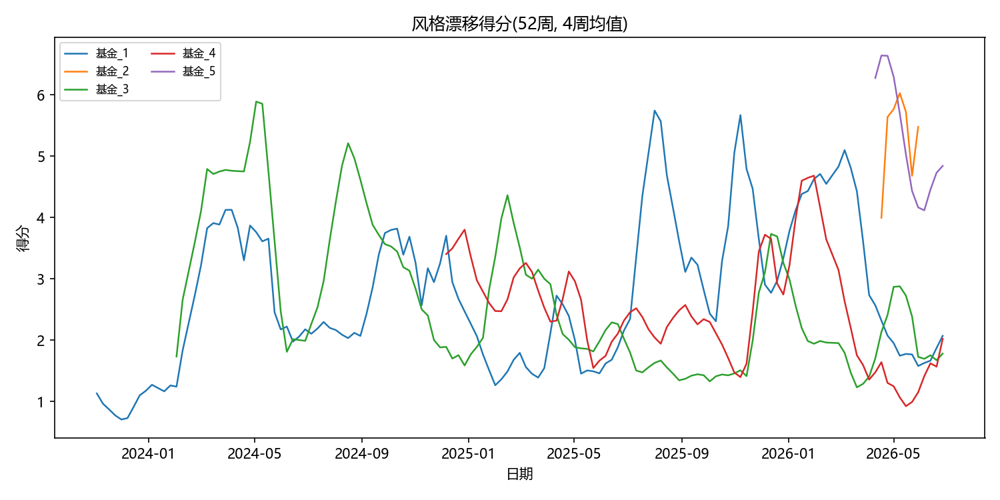
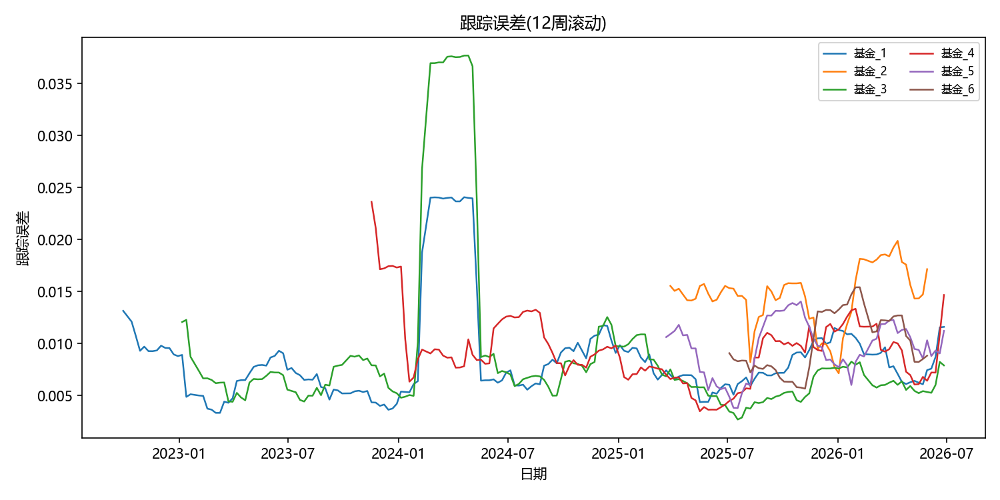
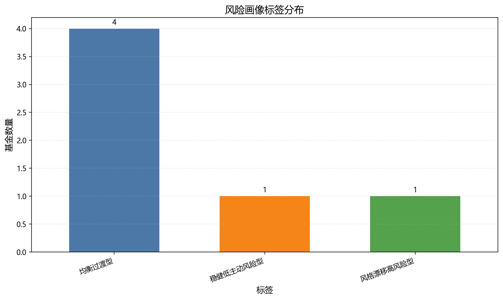

# 基于Barra因子敏感度的中证1000指数增强基金风险画像与风险预警研究

## 一、研究背景与目标

本项目面向基金风险研究场景，基于基金净值、中证1000指数与Barra因子序列，完成从风险暴露估计到未来风险预警的完整流程。  
研究目标不是预测“哪只基金收益最高”，而是识别“哪只基金未来风险可能升高”。

核心目标如下：

1. 估计基金对Barra因子的动态敏感度。
2. 构建基金风险画像，识别风格稳定性与主动风险特征。
3. 构建未来4周风险标签，检验风险预警可行性。
4. 使用轻量机器学习模型（Logistic/LASSO Logistic）与树模型（LightGBM/XGBoost）进行风险状态预测。

---

## 二、数据与样本说明

数据来源：

- 6只中证1000指数增强基金净值数据（周频为主，个别基金原始为日频后转周频）。
- 中证1000指数周线数据。
- Barra风格因子数据（先由因子水平序列转换为周收益）。

样本与对齐后规模：

- 基础面板（step2）：`744` 行，`20` 列。
- 覆盖时间：`2022-07-15` 至 `2026-06-26`。
- 基金数量：`6` 只。

说明：本项目使用非平衡面板，不强制所有基金样本长度一致。

---

## 三、方法流程与实现步骤

### Step1 数据读取

读取Barra原始数据、指数数据、基金净值数据。

### Step2 清洗与对齐

1. 基金复权净值转周收益率。  
2. 指数收盘价转周收益率。  
3. Barra因子水平转周收益率。  
4. 按“基金-日期”构建非平衡面板，生成：
   - `基金收益率`
   - `指数收益率`
   - `超额收益`
   - 各Barra因子周收益

### Step3 基础风险指标

按基金滚动12周计算：

- `跟踪误差_12周`
- `信息比率_12周`
- `最大回撤_12周`
- `胜率_12周`

有效样本数（每项）：`678`（前11周窗口不足为缺失值，属正常现象）。

### Step4 滚动Barra回归（核心）

滚动窗口：12周。  
模型形式：

\[
超额收益 = 截距 + 各因子暴露 \times 因子收益 + 残差
\]

当前采用核心5因子（稳健版本）：

- 规模
- 动量
- 流动性
- 波动率
- 账面市值比

输出：

- `超额收益截距_12周`
- `拟合优度_12周`
- `残差波动_12周`
- 各核心因子暴露（12周）

说明：仅使用5因子是因为12周窗口下若因子过多，会导致自由度不足、系数不稳定、解释性下降。

### Step5 风格漂移得分

对每个因子暴露计算相对52周滚动均值偏离：

\[
漂移幅度 = |当前暴露 - 52周滚动均值|
\]

再对多个因子漂移幅度求和，得到：

- `风格漂移得分_52周`
- `风格漂移得分_52周_4周均值`（短期平滑）

### Step6 基金风险画像

按基金聚合后，构建：

- Barra敏感度等级（高/中/低）
- 风格稳定性等级（稳定/中等/不稳定）
- 主动风险等级（高/中/低）
- 风险画像标签

### Step7 未来风险标签（前瞻4周）

构建以下目标变量：

- `未来高跟踪误差标签_4周`
- `未来回撤风险标签_4周`
- `未来高残差波动标签_4周`

标签口径：

- 跟踪误差、残差波动：按基金自身历史75%分位数阈值。
- 回撤风险：未来4周最大回撤 < -3% 记为1。

### Step8 机器学习预警

目标：预测 `未来高跟踪误差标签_4周`。  
模型：

- Logistic Regression
- LASSO Logistic Regression（变量筛选）
- LightGBM（非线性树模型）
- XGBoost（梯度提升树模型）

切分：按时间切分训练/测试，避免未来数据泄露。

### Step9 可视化与总览导出

已导出：

- 风格漂移曲线
- 跟踪误差曲线
- 风险画像标签分布图
- 项目总览工作簿与摘要文件

---

## 四、核心结果与解读

## 4.1 基金风险画像结果（step6）

| 基金 | Barra敏感度等级 | 风格稳定性等级 | 主动风险等级 | 风险画像标签 |
|---|---|---|---|---|
| 基金_1 | 低 | 中等 | 中 | 均衡过渡型 |
| 基金_2 | 高 | 不稳定 | 高 | 风格漂移高风险型 |
| 基金_3 | 低 | 稳定 | 低 | 稳健低主动风险型 |
| 基金_4 | 中 | 稳定 | 高 | 均衡过渡型 |
| 基金_5 | 中 | 不稳定 | 中 | 均衡过渡型 |
| 基金_6 | 高 | 中等 | 低 | 均衡过渡型 |

解读：

- `基金_2` 同时出现高敏感度+不稳定+高主动风险，属于重点监控对象。
- `基金_3` 风格稳定且主动风险低，呈现稳健特征。
- 其余基金处于中间状态，建议结合时间维度持续跟踪。

## 4.2 未来风险标签分布（step7）

平均标签占比：

- `未来高跟踪误差标签_4周`：约 `25.14%`
- `未来回撤风险标签_4周`：约 `33.47%`
- `未来高残差波动标签_4周`：约 `25.15%`

解读：

- 风险事件占比不算极端稀少，具备分类建模基础。
- 回撤风险占比相对更高，说明下行风险在样本期内较为值得关注。

## 4.3 机器学习预警结果（step8）

| 模型 | 分类阈值 | AUC | PR_AUC | Recall | Precision | F1 | Accuracy |
|---|---:|---:|---:|---:|---:|---:|---:|
| Logistic | 0.200 | 0.5102 | 0.3046 | 0.8780 | 0.3529 | 0.5035 | 0.4453 |
| LASSO Logistic | 0.350 | 0.4976 | 0.2991 | 0.7561 | 0.3827 | 0.5082 | 0.5312 |
| LightGBM | 0.640 | 0.5038 | 0.3380 | 0.0488 | 0.3333 | 0.0851 | 0.6641 |
| XGBoost | 0.430 | 0.5130 | 0.3091 | 0.0244 | 0.0769 | 0.0370 | 0.5938 |

LASSO筛选出的关键特征（11个）：

- 因子暴露_规模_12周
- 因子暴露_动量_12周
- 因子暴露_流动性_12周
- 因子暴露_波动率_12周
- 因子暴露_账面市值比_12周
- 超额收益截距_12周
- 残差波动_12周
- 信息比率_12周
- 最大回撤_12周
- 胜率_12周
- 风格漂移得分_52周_4周均值

解读：

- 线性模型（Logistic、LASSO）在本轮实验中Recall与F1明显优于树模型，更适合“宁可多报”的预警场景。
- 树模型（LightGBM、XGBoost）当前阈值下偏保守，误报少但漏报较多，需进一步调参和阈值策略优化。
- 四个模型AUC整体接近0.5，说明当前样本与特征下区分度仍偏弱，暂定位为研究辅助工具。

---

## 五、项目中“机器学习”的体现

本项目的机器学习部分体现在Step8：

1. 使用监督学习框架预测未来风险状态（二分类）。
2. 采用时间切分训练/测试，符合时序建模规范。
3. 在保留Logistic与LASSO的基础上，引入LightGBM与XGBoost进行非线性对照建模。
4. 使用验证集进行阈值优化，再在测试集统一输出AUC、PR_AUC、Recall、Precision、F1、混淆矩阵，形成完整评估闭环。

---

## 六、局限性与后续优化方向

1. 样本规模较小、基金数量有限，模型泛化能力受限。  
2. 12周窗口下为保证稳健性，核心回归仅选5个因子；其余因子可在后续稳健性分析中扩展。  
3. 目前预警目标以“未来高跟踪误差”为主，后续可增加多目标联合预警。  
4. 可考虑加入阈值优化、滚动重训练、类别不平衡处理等提升预测表现。  

---

## 七、结论

本项目已完成“风险识别 -> 风格漂移监控 -> 未来风险预警”的完整流程：

1. 成功估计6只基金的动态Barra因子暴露。  
2. 构建了可解释的基金风险画像体系，并识别出重点风险对象。  
3. 构建未来4周风险标签并完成Logistic、LASSO、LightGBM、XGBoost预警建模。  
4. 结果表明线性模型在当前数据上更稳健，树模型仍有优化空间，后续需通过样本扩充与特征增强继续提升。  

整体上，本研究较好匹配基金风险研究岗位对“解释性、监控性、可落地性”的要求。

---

## 八、关键图表附录

### 图A：风格漂移得分（52周，4周均值）

图A解读：

1. 该图反映各基金风格暴露相对自身长期均值（52周）的偏离程度，数值越高表示风格漂移越明显。  
2. `基金_1` 与 `基金_3` 在样本期内出现过多次抬升区间，说明其风格稳定性阶段性走弱，应结合市场环境进行重点复核。  
3. `基金_2`、`基金_5` 在样本后段出现较高点位，提示近期投资风格可能发生了较明显调整。  
4. 从风险监控角度，可将该指标作为“风格稳定性预警”信号，与跟踪误差、回撤等指标联合判断。  

### 图B：跟踪误差（12周滚动）

图B解读：

1. 该图展示各基金相对中证1000基准的主动偏离强度，跟踪误差越高，代表组合与基准差异越大。  
2. `基金_3` 在2024年初附近出现阶段性高位，表明当期主动风险暴露显著上升。  
3. 样本后段多数基金维持在较低至中等区间，说明整体偏离强度可控，但`基金_2`等个别产品仍有上行波动，需要持续跟踪。  
4. 在预警应用中，可将“跟踪误差上行 + 风格漂移抬升”作为联合触发条件，用于识别潜在风险抬头阶段。  

### 图C：风险画像标签分布

