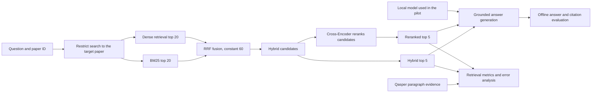

# Scientific RAG Evaluation

An independent evaluation of retrieval and reranking strategies for scientific question answering using Qasper. This project compares BM25, dense retrieval, Reciprocal Rank Fusion (RRF) hybrid retrieval, and hybrid retrieval with a Cross-Encoder reranker over paragraph-aligned passages.

## Research Questions

- Does hybrid retrieval improve evidence retrieval over dense retrieval?
- Does a Cross-Encoder improve ranking of retrieved candidates?
- Do retrieval gains translate into more reliable generated answers?
- What are the accuracy and latency trade-offs?

## Dataset and Evaluation Protocol

Qasper contains paper-grounded questions with paragraph evidence and multiple answer annotations. The project uses the official `train` split for development and the complete official `validation` split for held-out retrieval evaluation. Retrieval is restricted to the question's known `paper_id`, as in the dataset task. The validation split is not represented as the official test set.

The downloaded source revision and Hugging Face Parquet conversion revision, exact paper IDs, question IDs, data-quality summary, and sampling fingerprints are saved in `data/processed/dataset_manifest.json` after preparation. Each run configuration records its Python version and installed versions of the core dataset and retrieval packages. Raw downloaded data and model caches stay out of Git.

Prepared samples (seed 42):

| Split | Papers | Questions | Paragraph chunks |
|---|---:|---:|---:|
| Development (`train`) | 15 | 43 | 733 |
| Quick validation pilot | 50 | 181 | 2,541 |
| Full validation | 281 | 1,005 | 13,266 |

In full validation, 945 questions have at least one answerable annotation; 888 have mapped evidence and are included in retrieval metrics. Sixty are fully unanswerable and 75 have mixed answerability annotations. There are 382 unmapped evidence annotations among 2,808 answerable evidence items; these records remain preserved and are excluded from retrieval scoring rather than counted as retrieval failures. No question records were excluded due to alignment problems. Token-aware splitting expands the 13,266 source paragraphs to 13,315 retrieval passages.

## Retrieval Architectures

1. **BM25** ranks passages using token overlap.
2. **Dense** encodes paragraphs and queries with `sentence-transformers/multi-qa-MiniLM-L6-cos-v1`; vectors are persisted in ChromaDB.
3. **Hybrid** merges the top 20 results from BM25 and dense retrieval using RRF with constant 60.
4. **Hybrid + reranker** scores the top 20 hybrid candidates with `cross-encoder/ms-marco-MiniLM-L6-v2` and passes the top 5 onward.

The primary comparison uses token-aware passages with a maximum of 450 model tokens and 50-token overlap. Child passages retain their parent paragraph IDs so evidence matching stays at the annotation level. Dataset and model revisions are pinned in the run configuration. All four systems were run on CPU. A separate local generation pilot scored 80 outputs across four arms on 20 questions.



The main experiment evaluates retrieval and ranking on the validation split. The local pilot evaluates downstream answers on a separate 20-question sample.

## Current Results

The primary comparison covers the complete 281-paper validation split: 888 questions with at least one mapped answerable evidence passage, evaluated at final K=5. The table reports means and 95% paper-cluster bootstrap percentile intervals (2,000 replicates, seed 42; 276 scored paper clusters). Latency is measured per question on the local CPU host.

| Method | Recall@5 (95% CI) | MRR@5 (95% CI) | Hit@5 | Complete coverage@5 | Mean latency |
|---|---:|---:|---:|---:|---:|
| BM25 | 0.504 [0.470, 0.538] | 0.343 [0.315, 0.368] | 0.593 | 0.446 | 0.11 ms |
| Dense | 0.572 [0.539, 0.604] | 0.413 [0.384, 0.438] | 0.661 | 0.506 | 24.72 ms |
| Hybrid (RRF) | 0.593 [0.560, 0.626] | 0.428 [0.400, 0.454] | 0.687 | 0.526 | 22.89 ms |
| Hybrid + reranker | 0.644 [0.616, 0.673] | 0.496 [0.468, 0.522] | 0.736 | 0.577 | 310.77 ms |

Paired bootstrap intervals are above zero for Dense vs BM25 and Hybrid vs BM25 on all four metrics. Hybrid vs Dense intervals cross zero on all four metrics. The reranker improves all four metrics over Hybrid; for example, MRR@5 increases by 0.068 (95% CI [0.041, 0.094]) and Recall@5 by 0.050 ([0.025, 0.076]), with about 288 ms additional mean latency.


The [full validation report](docs/full_validation_report.md) contains paired effects, subgroup summaries, full-set candidate-depth error analysis, and limitations. The earlier [50-paper pilot](docs/experiment_report.md) and development-set ablations remain available as exploratory analyses. Raw predictions, timings, statistical summaries, and run configurations are generated under `results/experiments/` and are ignored by Git.

### Ablations and Error Analysis

Development-set top-K and chunking ablations are exploratory and use 36 eligible questions; they are not used to tune the held-out validation scores. In the full validation set, 20-candidate analysis separates misses with no evidence in the candidate list from evidence present outside the final top five. The reranker leaves 38 Hybrid candidate-generation failures unchanged and reduces ranking failures from 240 to 196. The [research report](docs/research_report.md) gives traceable question-level examples, including a reranking regression, and links a deterministic four-stratum case sample for review; these are review materials, not human-adjudicated findings.

Full-validation contexts for Dense, Hybrid, and Hybrid + reranker cover all 1,005 questions. The same stratified 20-question, four-arm batch was run locally with Qwen2.5-1.5B-Instruct and through the API with GPT-6 Luna. The local run validated 80 of 80 replies. The API run validated 75 of 80 replies and scored 17 questions with valid results in all four arms. On 12 questions with reference answers in that subset, API answer F1 rose from 0.1705 for Hybrid to 0.2526 after reranking, with a 95% paired interval of [−0.0020, 0.1885] for the difference. The [generation evaluation](docs/generation_evaluation.md#provider-pilot-results-2026-11-06) reports exclusions, abstention, citations, timing, and the token-based cost estimate.

The [research report](docs/research_report.md) summarizes the retrieval results, generation pilots, and two-round human review of 12 selected retrieval cases. The blinded A/B packet can be rebuilt with `scripts/prepare_error_case_review.py`. [Review protocol](docs/error_case_review_protocol.md)

The [English CV project description](docs/cv_project_description.md) summarizes the completed work.

## Setup

Python 3.11 is the target. Python 3.11.9 is installed in the project-local `.toolchains/python311` directory and used to create `.venv`. The current local check passed 87 tests and Ruff. Full validation, the 50-paper pilot, and development-set chunking and top-K ablations have been rerun locally. Full-validation metrics and pilot rankings reproduce the historical Python 3.13.16 outputs. The full and pilot error-analysis CSVs are byte-identical to their references, and the development ablation rows match. A separate Python 3.13.16 rerun of the historical pilot K=20 reranker reproduces the saved predictions and the Python 3.11.9 reproduction. Remote CI is configured and awaits a GitHub run.

```powershell
py -3.11 -m venv .venv
.venv\Scripts\Activate.ps1
python -m pip install -e ".[dev,retrieval,visualization]"
.\scripts\reproduce_experiments.ps1
python -m pytest
python -m ruff check .
```

The reproduction script prepares the deterministic dataset, runs the pilot and complete validation comparisons, development-set chunking and top-K ablations, pilot top-20 error-analysis candidates, cluster-bootstrap analyses, and figure generation. It accepts `-PythonExecutable` to select a Python binary and `-SkipDatasetPreparation` when the local prepared samples already exist. Full validation runs may take several minutes because the embedding and Cross-Encoder models are evaluated over 281 papers. Python 3.11.9 reruns are preserved separately in `results/experiments/python311_full_validation/`, `python311_pilot/`, and `python311_ablations/`; run `python scripts/compare_runtime_outputs.py` to compare them with the historical outputs and write an input-hashed parity report. CI is configured but has not run on GitHub. Hugging Face access is public; setting `HF_TOKEN` can raise download limits. The provider experiment requires an API key and explicit cost authorization. The local pilot uses pinned model weights and llama.cpp.

## Project Structure

- `src/scientific_rag/`: dataset processing, retrieval, reranking, and evaluation modules.
- `scripts/`: reproducible dataset preparation and experiment entry points.
- `scripts/reproduce_experiments.ps1`: end-to-end local reproduction of the reported retrieval results and figures.
- `scripts/compare_runtime_outputs.py`: compares saved Python 3.11 outputs against historical run predictions, metrics, and ablations.
- `scripts/validate_error_case_review.py`: checks recorded blinded-review fields and progress without reading the unblinding key or entering judgments.
- `scripts/analyze_error_case_review.py`: compares preserved stage-1 and stage-2 review records and summarizes supplied judgments using an explicit unblinding key.
- `scripts/evaluate_generation.py`: offline scoring of saved answer/citation predictions.
- `data/processed/`: local prepared subset and manifest (ignored by Git).
- `data/processed/full_validation/evaluation_captions.jsonl`: full-validation figure/table captions stored separately from paragraph retrieval data.
- `data/processed/full_validation/evaluation_sections.jsonl`: source section headings, including empty-body headings, stored separately for provenance checks.
- `results/experiments/`: local metrics, predictions, and configurations (ignored by Git).
- `results/ablation_results.csv`, `results/error_analysis.csv`: compact question-level analysis outputs.
- `tests/`: offline unit tests.
- `docs/`: methodology, data quality, full validation report, pilot report, generation evaluation rules, figures, and limitations.

## Limitations

The main comparison uses all 281 Qasper validation papers. Question-type subgroup estimates are less precise than the overall comparison. Evidence matching uses exact normalized paragraph text. The 382 unmapped evidence annotations are retained for diagnosis and excluded from paragraph retrieval scoring. Recall and complete coverage use the best-matching mapped evidence set among answerable annotators, while MRR and Hit use their union. Retrieval latency describes this local CPU host. The generation pilots use small, deliberately selected samples, and the paired API analysis excludes three questions with format failures. Remote CI awaits repository hosting and publication authorization.

## References

1. Dasigi et al. (2021). *A Dataset of Information-Seeking Questions and Answers Anchored in Research Papers*. NAACL-HLT. [ACL Anthology](https://aclanthology.org/2021.naacl-main.365/).
2. Qasper dataset card. [Hugging Face](https://huggingface.co/datasets/allenai/qasper).

See [`docs/full_validation_report.md`](docs/full_validation_report.md) for the main results, [`docs/experiment_report.md`](docs/experiment_report.md) for the pilot analysis, and [`docs/methodology.md`](docs/methodology.md) for the evaluation protocol.
