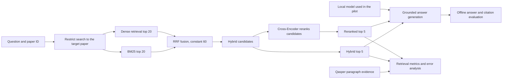
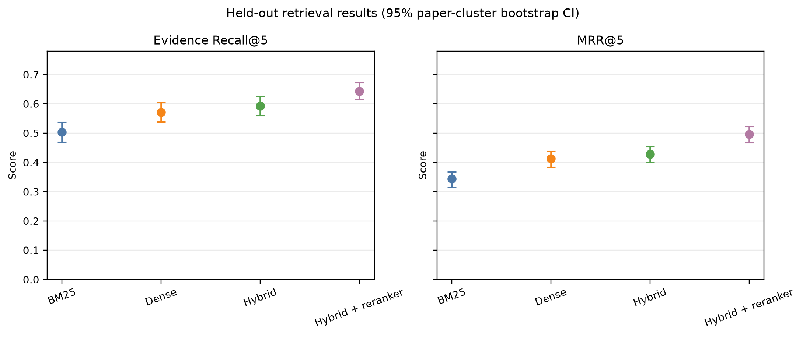

# 学术论文 RAG 检索与问答评估

本项目使用 Qasper 数据集，独立评估学术论文问答中的检索与重排序策略。以与原始段落对齐的文本片段为基础，比较 BM25、稠密检索、基于倒数排名融合（Reciprocal Rank Fusion，RRF）的混合检索，以及加入交叉编码器（Cross-Encoder）重排序的混合检索。

## 研究问题

- 与稠密检索相比，混合检索能否改善证据检索效果？
- 交叉编码器能否改善候选文本的排序？
- 检索效果的提升能否转化为更可靠的生成答案？
- 准确性与延迟之间存在怎样的权衡？

## 数据集与评估方案

Qasper 包含基于论文提出的问题、段落级证据以及多份答案标注。本项目使用官方 `train` 划分进行开发，使用完整的官方 `validation` 划分进行留出检索评估。按照数据集的任务设定，检索范围限定在问题已知的 `paper_id` 对应论文内。这里的验证集不被表述为官方测试集。

数据准备完成后，下载的数据源版本、Hugging Face Parquet 转换版本、具体论文 ID、问题 ID、数据质量摘要和抽样指纹均保存在 `data/processed/dataset_manifest.json` 中。每次运行的配置都会记录 Python 版本，以及核心数据集与检索依赖包的安装版本。下载的原始数据和模型缓存不纳入 Git。

已准备的样本如下（随机种子为 42）：

| 数据划分 | 论文数 | 问题数 | 段落片段数 |
|---|---:|---:|---:|
| 开发集（`train`） | 15 | 43 | 733 |
| 快速验证试验 | 50 | 181 | 2,541 |
| 完整验证集 | 281 | 1,005 | 13,266 |

在完整验证集中，945 个问题至少有一份标注认为可以回答，其中 888 个问题具有成功映射的证据，纳入检索指标计算。60 个问题的所有标注均认为无法回答，75 个问题的不同标注对是否可以回答存在分歧。在可回答标注对应的 2,808 条证据中，有 382 条未能完成映射；这些记录予以保留，并从检索评分中排除，而不是计作检索失败。没有问题记录因对齐问题而被删除。按模型 token 数量切分后，13,266 个原始段落形成 13,315 个检索片段。

## 检索架构

1. **BM25**：根据词项重合情况对文本片段排序。
2. **Dense（稠密检索）**：使用 `sentence-transformers/multi-qa-MiniLM-L6-cos-v1` 对段落和查询编码，并将向量持久化存储在 ChromaDB 中。
3. **Hybrid（混合检索）**：使用常数为 60 的 RRF，融合 BM25 和稠密检索各自排名前 20 的结果。
4. **Hybrid + reranker（混合检索＋重排序）**：使用 `cross-encoder/ms-marco-MiniLM-L6-v2` 对混合检索的前 20 个候选片段评分，并将排名前 5 的片段传递到后续环节。

主要比较采用按模型 token 数量切分的文本片段，每个片段最多 450 个 token，相邻片段重叠 50 个 token。子片段保留所属原始段落的 ID，使证据匹配仍在标注层面进行。数据集与模型版本在运行配置中固定。四种系统均在 CPU 上运行。另一个独立的本地生成试验使用 20 个问题，对四组方案共 80 个输出进行评分。



主实验在验证集上评估检索与排序效果。本地试验使用另一个包含 20 个问题的样本，评估下游生成答案。

## 当前结果

主要比较覆盖完整的 281 篇论文验证集，对至少具有一条已映射、可回答证据片段的 888 个问题进行评估，最终截取数量为 K=5。下表报告均值，以及按论文聚类进行 bootstrap 得到的 95% 百分位置信区间（重复抽样 2,000 次，随机种子为 42，共 276 个纳入评分的论文簇）。延迟在本地 CPU 主机上按问题测量。

| 方法 | Recall@5（95% CI） | MRR@5（95% CI） | Hit@5 | 完整证据覆盖率@5 | 平均延迟 |
|---|---:|---:|---:|---:|---:|
| BM25 | 0.504 [0.470, 0.538] | 0.343 [0.315, 0.368] | 0.593 | 0.446 | 0.11 ms |
| Dense | 0.572 [0.539, 0.604] | 0.413 [0.384, 0.438] | 0.661 | 0.506 | 24.72 ms |
| Hybrid (RRF) | 0.593 [0.560, 0.626] | 0.428 [0.400, 0.454] | 0.687 | 0.526 | 22.89 ms |
| Hybrid + reranker | 0.644 [0.616, 0.673] | 0.496 [0.468, 0.522] | 0.736 | 0.577 | 310.77 ms |

在四项指标上，Dense 相对 BM25、Hybrid 相对 BM25 的配对 bootstrap 差值区间均高于零。Hybrid 相对 Dense 的四项指标差值区间均跨越零。加入重排序器后，四项指标均优于 Hybrid；例如，MRR@5 提高 0.068（95% CI [0.041, 0.094]），Recall@5 提高 0.050（[0.025, 0.076]），平均延迟增加约 288 ms。



[完整验证报告](docs/full_validation_report.md)包含配对效应、子组汇总、完整验证集的候选深度错误分析及局限性。此前的[50 篇论文试验](docs/experiment_report.md)和开发集消融实验仍保留为探索性分析。原始预测、计时结果、统计汇总和运行配置生成在 `results/experiments/` 下，并由 Git 忽略。

### 消融实验与错误分析

开发集上的 top-K 和文本切分消融实验属于探索性分析，使用 36 个符合条件的问题，不用于调优留出验证集的评分。在完整验证集中，基于 20 个候选片段的分析区分了两类遗漏：候选列表中完全没有证据，以及证据已进入候选列表但未进入最终前五名。重排序器未改变 Hybrid 的 38 个候选生成失败案例，并将排序失败案例从 240 个减少到 196 个。[研究报告](docs/research_report.md)提供了可追溯到具体问题的示例，包括一个重排序后效果变差的案例，并链接了按固定规则抽取的四层案例样本以供审阅；这些属于审阅材料，不应视为经人工裁定的结论。

Dense、Hybrid 和 Hybrid + reranker 的完整验证集上下文覆盖全部 1,005 个问题。同一批分层抽取的 20 个问题、四组方案，分别使用 Qwen2.5-1.5B-Instruct 在本地运行，以及通过 API 使用 GPT-6 Luna 运行。本地运行的 80 个回复全部通过有效性校验。API 运行的 80 个回复中有 75 个通过校验，最终对四组结果均有效的 17 个问题进行评分。在该子集中具有参考答案的 12 个问题上，API 答案 F1 从 Hybrid 的 0.1705 提高至重排序后的 0.2526，差值的 95% 配对区间为 [−0.0020, 0.1885]。[生成评估](docs/generation_evaluation.md#provider-pilot-results-2026-11-06)报告了排除情况、拒答、引用、耗时及基于 token 用量的成本估算。

[研究报告](docs/research_report.md)总结了检索结果、生成试验，以及对 12 个选定检索案例开展的两轮人工审阅。可使用 `scripts/prepare_error_case_review.py` 重新生成盲评 A/B 材料包。[审阅方案](docs/error_case_review_protocol.md)

[英文简历项目描述](docs/cv_project_description.md)概括了已完成的工作。

## 环境配置

目标版本为 Python 3.11。Python 3.11.9 安装在项目本地的 `.toolchains/python311` 目录中，并用于创建 `.venv`。当前本地检查已通过 87 项测试和 Ruff 检查。完整验证集、50 篇论文试验，以及开发集的文本切分和 top-K 消融实验，均已在本地重新运行。完整验证集指标和试验排名复现了历史 Python 3.13.16 输出。完整验证集和试验的错误分析 CSV 与参考文件逐字节一致，开发集消融实验的各行结果也一致。另一次使用 Python 3.13.16 对历史试验中 K=20 重排序器的重新运行，复现了已保存的预测及 Python 3.11.9 的复现结果。远程 CI 已配置，等待在 GitHub 上运行。

```powershell
py -3.11 -m venv .venv
.venv\Scripts\Activate.ps1
python -m pip install -e ".[dev,retrieval,visualization]"
.\scripts\reproduce_experiments.ps1
python -m pytest
python -m ruff check .
```

复现脚本会按固定规则准备数据集，运行试验集与完整验证集比较、开发集文本切分与 top-K 消融实验、试验集前 20 个候选片段的错误分析、聚类 bootstrap 分析及图表生成。可使用 `-PythonExecutable` 指定 Python 可执行程序；本地已存在准备好的样本时，可使用 `-SkipDatasetPreparation` 跳过数据准备。由于需要在 281 篇论文上运行嵌入模型和交叉编码器，完整验证过程可能需要数分钟。Python 3.11.9 的重新运行结果分别保存在 `results/experiments/python311_full_validation/`、`python311_pilot/` 和 `python311_ablations/` 中；运行 `python scripts/compare_runtime_outputs.py` 可将其与历史输出比较，并写出带输入哈希的结果一致性报告。CI 已配置，但尚未在 GitHub 上运行。Hugging Face 资源可公开访问，设置 `HF_TOKEN` 可以提高下载限额。调用模型服务商的实验需要 API 密钥和明确的费用授权。本地试验使用固定版本的模型权重和 llama.cpp。

## 项目结构

- `src/scientific_rag/`：数据集处理、检索、重排序和评估模块。
- `scripts/`：可复现的数据准备与实验入口。
- `scripts/reproduce_experiments.ps1`：在本地端到端复现报告中的检索结果和图表。
- `scripts/compare_runtime_outputs.py`：将已保存的 Python 3.11 输出与历史运行的预测、指标和消融实验结果比较。
- `scripts/validate_error_case_review.py`：检查已记录的盲评字段和进度，不读取揭盲密钥，也不代填判断。
- `scripts/analyze_error_case_review.py`：比较保留的第一阶段与第二阶段审阅记录，并使用明确提供的揭盲密钥汇总已有判断。
- `scripts/evaluate_generation.py`：对已保存的答案与引用预测进行离线评分。
- `data/processed/`：本地准备的数据子集与清单（由 Git 忽略）。
- `data/processed/full_validation/evaluation_captions.jsonl`：完整验证集的图表说明，与段落检索数据分开存储。
- `data/processed/full_validation/evaluation_sections.jsonl`：原始章节标题，包括正文为空的标题，单独存储以供来源核查。
- `results/experiments/`：本地指标、预测与配置（由 Git 忽略）。
- `results/ablation_results.csv`、`results/error_analysis.csv`：精简的问题级分析输出。
- `tests/`：离线单元测试。
- `docs/`：方法、数据质量、完整验证报告、试验报告、生成评估规则、图表与局限性。

## 局限性

主要比较使用 Qasper 验证集的全部 281 篇论文。按问题类型划分的子组估计不如整体比较精确。证据匹配要求规范化后的段落文本完全一致。382 条未能映射的证据标注保留用于诊断，并从段落检索评分中排除。Recall 和完整证据覆盖率使用各可回答标注者中匹配最佳的已映射证据集，MRR 和 Hit 则使用这些证据集的并集。检索延迟反映的是本地 CPU 主机的表现。生成试验使用规模较小、经过有意选择的样本，配对 API 分析排除了三个存在格式失败的问题。远程 CI 仍等待仓库托管及发布授权。

## 参考文献

1. Dasigi et al. (2021). *A Dataset of Information-Seeking Questions and Answers Anchored in Research Papers*. NAACL-HLT. [ACL Anthology](https://aclanthology.org/2021.naacl-main.365/)。
2. Qasper 数据集说明。[Hugging Face](https://huggingface.co/datasets/allenai/qasper)。

主要结果见 [`docs/full_validation_report.md`](docs/full_validation_report.md)，试验分析见 [`docs/experiment_report.md`](docs/experiment_report.md)，评估方案见 [`docs/methodology.md`](docs/methodology.md)。
