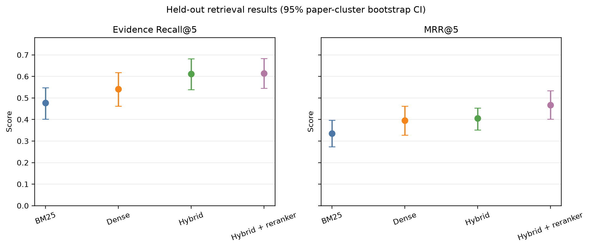
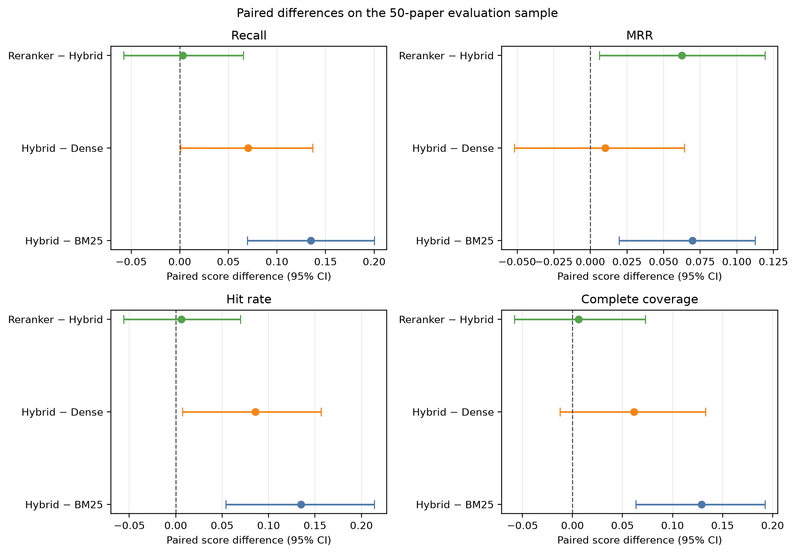
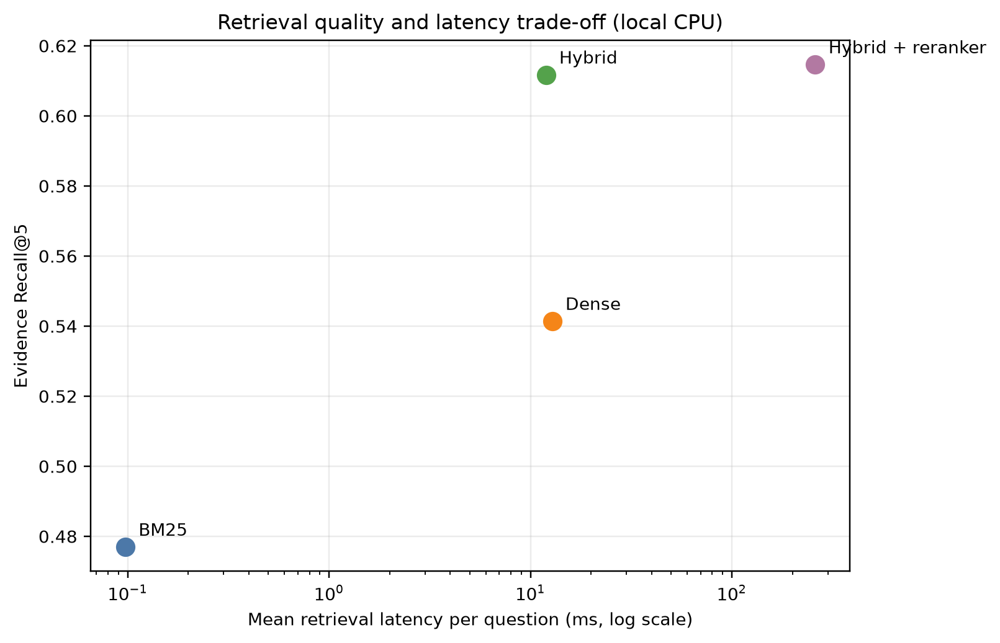
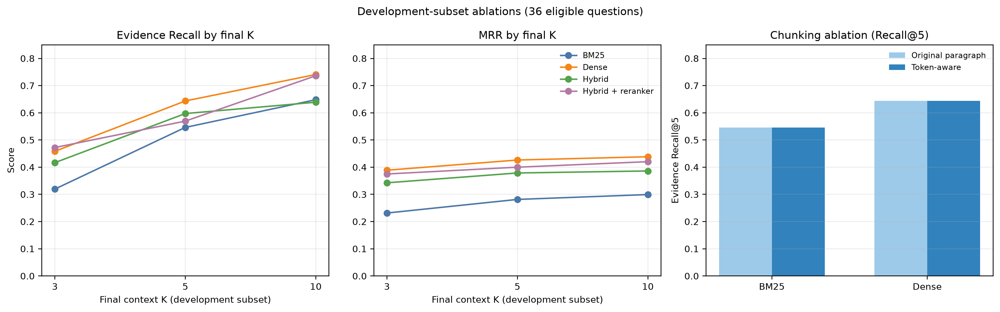
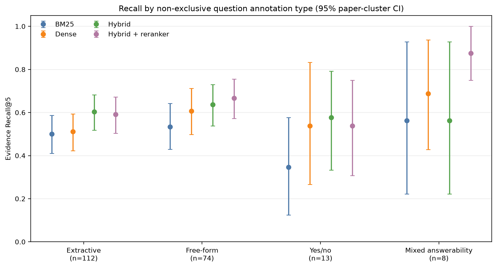

# Scientific RAG Retrieval Evaluation: Interim Report

**Status:** Local, reproducible retrieval experiments completed on a small validation subset. This is an interim report, not a final paper.  
**Dataset:** Qasper, deterministic 50-paper subset of the official validation split.  
**Primary evaluation:** 163 answerable questions with at least one mapped evidence paragraph; all four methods use the same questions.

## Abstract

This study compares lexical, dense, hybrid, and reranked retrieval for paper-grounded scientific question answering. Evidence is retrieved from the question's source paper using token-aware passages, with paragraph-level gold evidence retained as the scoring unit. On the selected 50-paper Qasper validation subset, Reciprocal Rank Fusion (RRF) improves evidence recall, hit rate, and complete evidence coverage over BM25. The paired paper-cluster bootstrap intervals for these Hybrid-versus-BM25 differences are above zero in this subset. Dense retrieval is numerically above BM25, but its paired intervals cross zero for each reported metric. A Cross-Encoder reranker produces the clearest incremental improvement in MRR over Hybrid, with little change in recall and substantially higher CPU latency. Small sample size, exact-match evidence alignment, and the absence of answer generation and human review limit the conclusions.

## 1. Motivation and questions

Scientific question answering depends on locating evidence in long research papers. A retrieval system may miss an evidence paragraph, or retrieve it but rank it below the context limit. This project separates those cases and evaluates four retrieval strategies before any answer generator is introduced.

The current retrieval phase addresses:

1. Does hybrid retrieval improve evidence retrieval over BM25 and dense retrieval?
2. Does a Cross-Encoder improve the ranking of candidates already retrieved by the hybrid system?
3. What retrieval-quality and latency trade-offs appear on the selected subset?

Whether retrieval gains improve generated answers remains unanswered. No answer generation has been run.

## 2. Data and evaluation set

Qasper questions are linked to research papers and carry multiple answer annotations, including answerability, answer text, and evidence. We sampled papers deterministically with seed 42: 15 from `train` for development and 50 from `validation` for held-out evaluation. The evaluation subset has 181 questions, including 174 questions with at least one answerable annotation. Of those, 163 have at least one answerable evidence item mapped to a source paragraph and are included in retrieval metrics. Seven questions are fully unanswerable and ten include both answerable and unanswerable annotations.

Exact normalized text matching maps 454 of 539 answerable evidence items (84.2%). The other 85 items remain in the prepared data and are not counted as retrieval misses. No question records were removed for question/answer alignment errors. The 2,541 nonempty source paragraphs become 2,553 token-aware retrieval passages; child passages retain their source paragraph ID.

The source dataset revision is `fdc9d8214fbab5dd782958601db4d678e6934a54`. Because current Hugging Face `datasets` versions no longer execute the dataset's loading script, the loader uses the official Parquet conversion pinned at `06806e4608976fc2fac0a090ac425d5b2b29caf4`. Exact sampled paper and question IDs and fingerprints are saved in the local manifest.

## 3. Methods

All methods search only within the paper associated with the question, consistent with the dataset setup. The primary runs use token-aware passages with a maximum of 450 model tokens and 50-token overlap. Retrieved child passages map back to parent paragraph IDs for evidence scoring. The final context depth is K=5.

| Method | Description |
|---|---|
| BM25 | Case-folded alphanumeric tokenization and lexical ranking. |
| Dense | Normalized Sentence Transformer embeddings with cosine similarity. |
| Hybrid | Reciprocal Rank Fusion of the top 20 BM25 and top 20 dense candidates, RRF constant 60. |
| Hybrid + reranker | Cross-Encoder reranks the top 20 hybrid candidates, then returns the top 5. |

The embedding model is `sentence-transformers/multi-qa-MiniLM-L6-cos-v1` at `b207367332321f8e44f96e224ef15bc607f4dbf0`. The reranker is `cross-encoder/ms-marco-MiniLM-L6-v2` at `233902d25c440f23af6f7d6e94d2946bac0bee0a`. Experiments ran on CPU under Python 3.13.16.

### Metrics

- **Evidence Recall@5:** fraction of mapped relevant paragraphs retrieved in the top five, using the best-matching valid answer annotation set.
- **MRR@5:** reciprocal rank of the first relevant paragraph in the top five, with relevant evidence taken across answerable annotations.
- **Hit Rate@5:** share of questions with at least one relevant paragraph in the top five.
- **Complete Evidence Coverage@5:** share with a full valid annotated evidence set covered in the top five, using the best-matching answer annotation set.
- **Latency:** measured retrieval time per question on this local CPU host.

The primary table reports macro means over the same 163 questions. Confidence intervals use 2,000 percentile bootstrap replicates over paper clusters (seed 42). Paired comparisons bootstrap paper-level per-question score differences. The intervals quantify uncertainty within this selected sample; they do not correct for subset selection.

## 4. Primary results

| Method | Recall@5 (95% CI) | MRR@5 (95% CI) | Hit@5 | Complete coverage@5 | Mean latency | P95 latency |
|---|---:|---:|---:|---:|---:|---:|
| BM25 | 0.477 [0.402, 0.548] | 0.336 [0.274, 0.396] | 0.589 | 0.405 | 0.10 ms | 0.17 ms |
| Dense | 0.541 [0.461, 0.618] | 0.395 [0.328, 0.462] | 0.638 | 0.472 | 12.82 ms | 15.31 ms |
| Hybrid (RRF) | 0.612 [0.538, 0.681] | 0.405 [0.351, 0.453] | 0.724 | 0.534 | 11.94 ms | 13.34 ms |
| Hybrid + reranker | 0.615 [0.545, 0.683] | 0.468 [0.401, 0.533] | 0.730 | 0.540 | 259.70 ms | 467.73 ms |

### Paired comparisons

The Hybrid-minus-BM25 mean difference is +0.135 in Recall@5 (95% CI [0.069, 0.200]), +0.070 in MRR@5 ([0.020, 0.113]), +0.135 in Hit@5 ([0.054, 0.214]), and +0.129 in complete evidence coverage ([0.063, 0.193]). These intervals are above zero for the four metrics in this sample.

Hybrid-minus-Dense differences are +0.070 in Recall@5 ([0.001, 0.137]) and +0.086 in Hit@5 ([0.007, 0.157]); the MRR difference (+0.010, [-0.052, 0.064]) and complete coverage difference (+0.061, [-0.012, 0.133]) have intervals crossing zero.

Reranker-minus-Hybrid is +0.062 MRR@5 ([0.006, 0.119]). The other paired differences have intervals crossing zero: Recall@5 +0.003 ([-0.058, 0.065]), Hit@5 +0.006 ([-0.056, 0.070]), and complete coverage +0.006 ([-0.058, 0.073]). This pattern suggests that in this sample reranking mostly moves already retrieved evidence earlier in the list. Mean reranking latency is approximately 245 ms per question, raising the full hybrid pipeline mean from 11.94 ms to 259.70 ms.

## 5. Ablations and error analysis

### Final context depth

On the 36 eligible development questions, increasing K generally raises evidence recall and hit rate. At K=10, Dense reaches 0.741 recall and Hybrid + reranker 0.736; corresponding K=5 recall is 0.644 and 0.569. MRR changes less with K, as expected because its value is determined by the rank of the first relevant paragraph. These development results are exploratory and were not used to tune the held-out comparison.

### Chunking

The development-set K=5 comparison between original paragraphs and 450-token passages with 50-token overlap is nearly unchanged in aggregate. BM25 recall is 0.546 for both variants (MRR 0.283 vs 0.282). Dense recall is 0.644 for both (MRR 0.426 for both). The current subset has few paragraphs long enough for splitting to change retrieved evidence, so this does not establish that chunking choice is immaterial on longer papers or a larger corpus.

### Errors

The error analysis classifies question-method cases where no mapped evidence appears in the final top five. For BM25, 21 cases had no evidence in the top-20 candidate list (retrieval failure) and 46 had evidence in that list but not in the final five (ranking failure). For Dense the counts are 12 and 47; Hybrid 10 and 35; Hybrid + reranker 10 and 34. These are counts of method-question error cases, not counts of unique questions. They indicate that ranking within a candidate set accounts for more observed misses than candidate generation on this subset.

Question-type results are non-exclusive because one question can have multiple answer annotation types. Small groups (13 scored yes/no questions and 8 mixed-answerability questions) have wide uncertainty intervals and should be read as descriptive only.

## 6. Interpretation

Within the selected subset, the clearest retrieval result is that RRF improves over BM25 on all four reported evidence metrics, and improves Recall@5 and Hit@5 over Dense under the paired cluster bootstrap. Dense alone is numerically better than BM25, but the intervals do not resolve that contrast in this sample. The Cross-Encoder contributes a measurable MRR increase over Hybrid, while its recall and coverage effects remain uncertain and the latency cost is large.

The absolute scores should not be used as estimates for all Qasper papers. The study covers only 50 validation papers and 163 scored questions; question-type subgroups are smaller still. In addition, retrieval metrics measure alignment to available evidence annotations, not answer correctness, citation quality, or usefulness to a researcher.

## 7. Limitations and next work

1. Expand held-out evaluation to the full Qasper validation split, then evaluate on the official test split if a suitable protocol is available.
2. Audit the 85 unmapped evidence annotations and a sample of mapped cases to estimate how exact matching affects scoring.
3. Run the configured Python 3.11 CI and capture the result; the full-validation retrieval comparison has since been reproduced locally under Python 3.11.9, but CI remains unrun.
4. Add a generation phase only after a real provider/key and explicit spending limit are configured; evaluate answer quality, citation correctness, abstention, and cost without conflating retrieval metrics.
5. Conduct human review of failure categories and figure/table evidence before making claims about scientific answer quality.

### Python 3.11.9 reproduction

The 50-paper pilot and development ablations have since been rerun in Python 3.11.9 without replacing the original outputs. The four pilot methods return identical ranked passage IDs, chunk IDs, texts, and scores at K=5 and K=20. All saved K=5 and available K=20 metric summaries agree within 1e-12. The historical Hybrid + reranker K=20 folder contains its prediction file but no config or metric CSV; the original-file parity report correctly records those reference fields as unavailable. To recover the missing reproducibility metadata without changing history, the same K=20 run was independently repeated offline under Python 3.13.16 at `results/experiments/python313_reconstructed/pilot/candidates20/hybrid_reranked/`. All retrieved IDs, text, scores, and evidence sets match both the historical predictions and the Python 3.11.9 run; per-question metrics agree with Python 3.11.9 within 1e-12, and protocol/model/data pins match. This later reconstruction has its own config, metrics, summary, and comparison manifest. Its summary metrics are evidence recall 0.87687, MRR 0.49082, hit rate 0.93865, and complete evidence coverage 0.83436. These metrics describe the reconstructed run; they are not backfilled into the historical folder. The pilot error-analysis CSV is byte-identical (SHA-256 `74348E983428274D59E4237BA6A72CC4F47687358C42B80FA7CEC90E54E7D225`). The 576 development ablation rows match the original table by question, method, study, and metric to 12 decimal places. The new outputs and 2,000-replicate pilot bootstrap are under `results/experiments/python311_pilot/` and `results/experiments/python311_ablations/`; five local figure pairs (PNG/PDF) were generated from those outputs. Latency is not compared across the two environments.

No LLM answers, answer F1, citation accuracy, API costs, external CI runs, or human-review findings are reported here because those measurements have not occurred.

## References

Dasigi, P. et al. (2021). *A Dataset of Information-Seeking Questions and Answers Anchored in Research Papers*. NAACL-HLT. [ACL Anthology](https://aclanthology.org/2021.naacl-main.365/).

Cormack, G. V., Clarke, C. L. A., and Büttcher, S. (2009). *Reciprocal Rank Fusion outperforms Condorcet and individual rank learning methods*. SIGIR. [DOI](https://doi.org/10.1145/1571941.1572114).

Reimers, N. and Gurevych, I. (2019). *Sentence-BERT: Sentence Embeddings using Siamese BERT-Networks*. [arXiv:1908.10084](https://arxiv.org/abs/1908.10084).

Nogueira, R. and Cho, K. (2019). *Passage Re-ranking with BERT*. [arXiv:1901.04085](https://arxiv.org/abs/1901.04085).

Qasper dataset card: [Hugging Face](https://huggingface.co/datasets/allenai/qasper).
