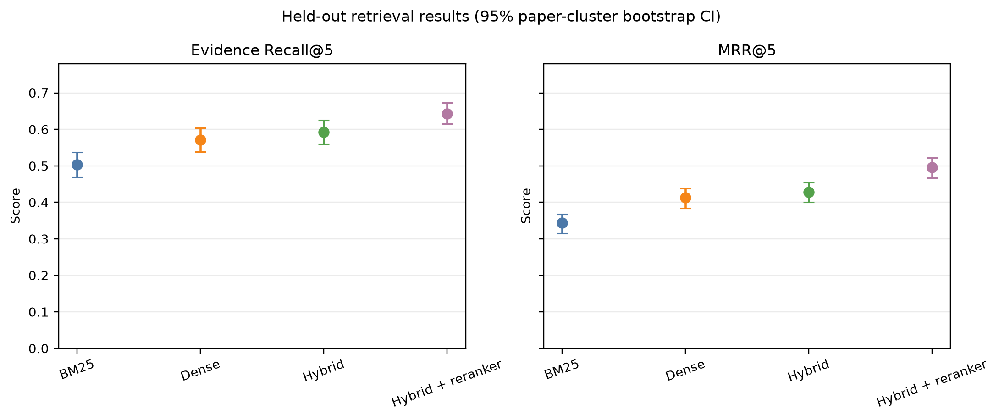
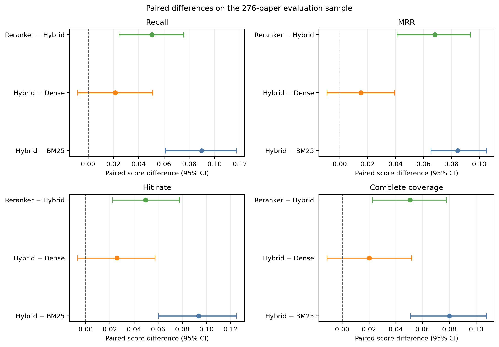
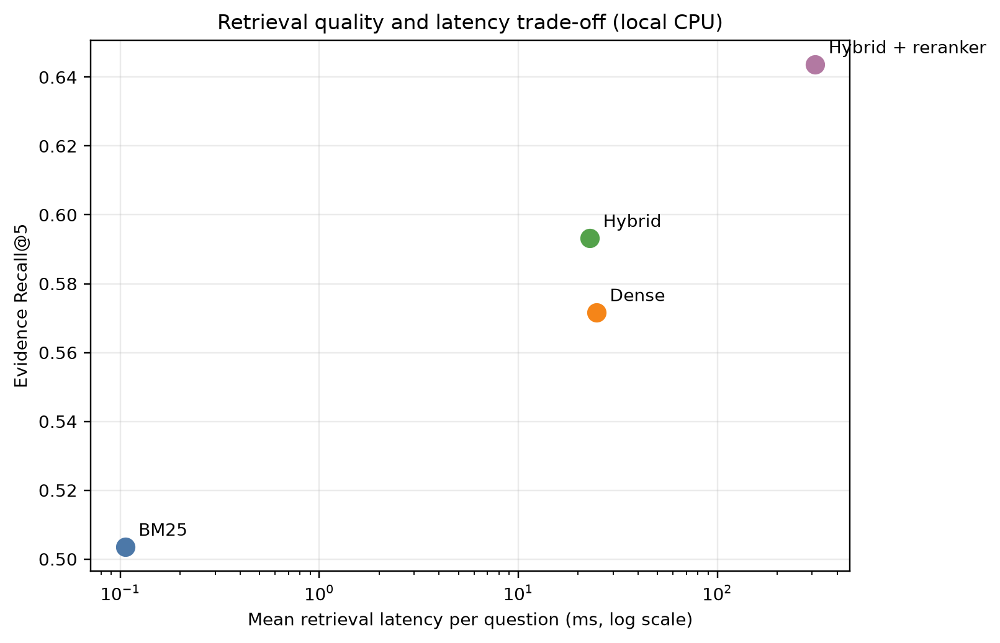
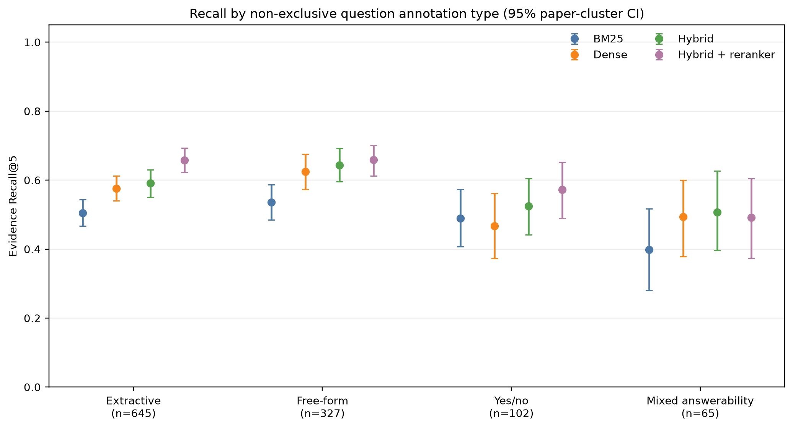

# Qasper Full Validation Retrieval Comparison

**Status:** Complete retrieval-only evaluation of the official Qasper validation split. This report supersedes the 50-paper pilot for the main retrieval comparison.  
**Split:** All 281 validation papers (1,005 questions); 888 answerable questions with mapped evidence were scored.  
**Bootstrap:** 2,000 paired paper-cluster replicates, seed 42, percentile 95% intervals.

## Summary

We evaluated BM25, dense retrieval, RRF Hybrid, and Hybrid with a Cross-Encoder reranker on the same 888 scoreable questions. Across this full validation split, Dense and Hybrid both improve over BM25 on all four retrieval metrics under paired paper-cluster bootstrap intervals. Hybrid does not clearly improve over Dense: its paired intervals cross zero on every metric. Adding the reranker improves all four metrics over Hybrid in this split, while mean local CPU latency rises from 22.9 ms to 310.8 ms per question.

These are results on the complete validation split, not the official test split, and measure retrieval against available evidence annotations rather than generated answer quality.

## Dataset and scoring coverage

The sampled data contains all 281 validation papers and 1,005 questions. Of these, 945 have at least one answerable annotation, 60 are fully unanswerable, and 75 contain both answerable and unanswerable annotations. Exact normalized text matching maps 2,426 of 2,808 answerable evidence items (86.4%). The 382 unmapped evidence items remain in the data and are not treated as retrieval failures. The 888 scored questions span 276 paper clusters; five papers have no eligible mapped-evidence question.

Full-validation figure/table captions and source section headings are exported separately from the paragraph retrieval corpus. A same-paper exact caption check accounts for all 253 unmapped evidence items carrying the `FLOAT SELECTED:` marker. The other 129 exactly match source section headings; 2 of these headings have no nonempty paragraph in the converted source. None of these caption or heading matches are paragraph retrieval hits or affect scoring. See the [unmapped-evidence diagnostic](unmapped_evidence_analysis.md) for matching rules and limitations.

The source repository revision is `fdc9d8214fbab5dd782958601db4d678e6934a54`; the Hugging Face Parquet conversion revision is `06806e4608976fc2fac0a090ac425d5b2b29caf4`. Sampling seed 42 and the complete sampled IDs and fingerprints are in the local manifest. The 13,266 nonempty paragraph units expand to 13,315 token-aware retrieval passages (450-token maximum, 50-token overlap).

## Methods

All systems search only within the paper associated with each question, use token-aware passages, and return K=5. Hybrid fuses the top 20 BM25 and dense candidates with RRF constant 60. The reranker rescores those same 20 candidates. The embedding model revision is `b207367332321f8e44f96e224ef15bc607f4dbf0`; the reranker revision is `233902d25c440f23af6f7d6e94d2946bac0bee0a`. All runs used CPU. The RRF formulation follows [Cormack et al. (2009)](https://doi.org/10.1145/1571941.1572114), the dense embedding approach follows Sentence-BERT [Reimers and Gurevych (2019)](https://arxiv.org/abs/1908.10084), and the pairwise passage reranking setup follows [Nogueira and Cho (2019)](https://arxiv.org/abs/1901.04085).

Recall and complete evidence coverage use the best-matching valid answer annotation set. MRR and Hit use the union of mapped relevant paragraphs across answerable annotations. Confidence intervals resample papers to preserve within-paper question clustering. Paired intervals are computed from per-question metric differences within the same papers.

## Results

| Method | Recall@5 (95% CI) | MRR@5 (95% CI) | Hit@5 (95% CI) | Complete coverage@5 (95% CI) | Mean latency | P95 latency |
|---|---:|---:|---:|---:|---:|---:|
| BM25 | 0.504 [0.470, 0.538] | 0.343 [0.315, 0.368] | 0.593 [0.555, 0.629] | 0.446 [0.410, 0.480] | 0.11 ms | 0.20 ms |
| Dense | 0.572 [0.539, 0.604] | 0.413 [0.384, 0.438] | 0.661 [0.625, 0.696] | 0.506 [0.471, 0.541] | 24.72 ms | 32.14 ms |
| Hybrid (RRF) | 0.593 [0.560, 0.626] | 0.428 [0.400, 0.454] | 0.687 [0.654, 0.720] | 0.526 [0.488, 0.563] | 22.89 ms | 26.84 ms |
| Hybrid + reranker | 0.644 [0.616, 0.673] | 0.496 [0.468, 0.522] | 0.736 [0.707, 0.766] | 0.577 [0.546, 0.609] | 310.77 ms | 536.56 ms |

### Paired differences

| Contrast (right minus left) | Recall@5 | MRR@5 | Hit@5 | Complete coverage@5 |
|---|---:|---:|---:|---:|
| Dense − BM25 | +0.068 [0.030, 0.107] | +0.069 [0.040, 0.101] | +0.068 [0.026, 0.109] | +0.060 [0.021, 0.100] |
| Hybrid − BM25 | +0.090 [0.061, 0.117] | +0.085 [0.065, 0.105] | +0.094 [0.060, 0.125] | +0.080 [0.051, 0.107] |
| Hybrid − Dense | +0.022 [-0.008, 0.051] | +0.015 [-0.009, 0.039] | +0.026 [-0.007, 0.057] | +0.020 [-0.011, 0.052] |
| Reranker − Hybrid | +0.050 [0.025, 0.076] | +0.068 [0.041, 0.094] | +0.050 [0.022, 0.077] | +0.051 [0.023, 0.078] |

The Dense-minus-BM25 and Hybrid-minus-BM25 paired intervals are above zero for every metric. Hybrid's point estimates exceed Dense's, but the paired intervals include zero for all four metrics. The reranker-minus-Hybrid intervals are above zero for all four metrics. In this complete validation split, reranking improves both evidence discovery and rank ordering; the incremental mean latency is about 288 ms per question.

Question-type summaries are non-exclusive. The full split includes 645 scored extractive questions, 327 free-form, 102 yes/no, and 65 mixed-answerability questions. Smaller category estimates remain descriptive.

## Candidate depth and error analysis

For each method, we retained 20 candidates and compared them with the final top-five context. Evidence Recall@20 is 0.841 for BM25, 0.901 for Dense, and 0.906 for both Hybrid and Hybrid + reranker. The reranker reorders the same Hybrid candidate set, so its candidate Recall@20 is unchanged by design.

| Method | Top-5 misses | No mapped evidence in top 20 (retrieval failure) | Evidence in top 20, outside top 5 (ranking failure) |
|---|---:|---:|---:|
| BM25 | 361 | 88 | 273 |
| Dense | 301 | 53 | 248 |
| Hybrid | 278 | 38 | 240 |
| Hybrid + reranker | 234 | 38 | 196 |

These counts are method-question cases among 888 eligible questions. The reranker leaves the number of candidate-generation failures unchanged and moves 44 evidence-bearing cases into the top-five context. This corresponds to a +0.050 Hit@5 change over Hybrid in the paired evaluation. The full per-question classifications are in the local `results/experiments/full_validation/error_analysis.csv` output.

## Limitations

- This is a full validation split result, not a test-set result or an independent replication.
- Evidence labels are incomplete under exact normalized matching: 382 answerable evidence items do not map to a source paragraph and are omitted from retrieval metrics.
- Retrieval evidence coverage is not answer correctness. No LLM generation, citation validation, answer quality, API cost, or human review was measured.
- CPU timing is specific to this machine and run configuration; it does not estimate service throughput.
- Subgroup estimates are less precise than the overall comparison, especially for yes/no and mixed-answerability questions.

## Artifacts and reproduction

The primary full-validation outputs are under `results/experiments/full_validation/` (Python 3.13.16). A separate Python 3.11.9 rerun of all four K=5 methods, all four K=20 candidate sets, 2,000 paper-cluster bootstrap replicates, and error analysis is under `results/experiments/python311_full_validation/`. K=5 and K=20 retrieval metrics agree within 1e-12, and the error-analysis CSV is byte-identical across runs. These generated outputs are ignored by Git. The reproducible entry point is `scripts/reproduce_experiments.ps1`; analysis uses `--question-file data/processed/full_validation/evaluation_questions.jsonl` to compute subgroup and error summaries against the correct full-split questions. Remote CI has not been run.

## References

- Dasigi, P. et al. (2021). *A Dataset of Information-Seeking Questions and Answers Anchored in Research Papers*. [ACL Anthology](https://aclanthology.org/2021.naacl-main.365/).
- Qasper dataset card: [Hugging Face](https://huggingface.co/datasets/allenai/qasper).
- Cormack, G. V., Clarke, C. L. A., and Büttcher, S. (2009). *Reciprocal Rank Fusion outperforms Condorcet and individual rank learning methods*. [DOI](https://doi.org/10.1145/1571941.1572114).
- Reimers, N. and Gurevych, I. (2019). *Sentence-BERT: Sentence Embeddings using Siamese BERT-Networks*. [arXiv](https://arxiv.org/abs/1908.10084).
- Nogueira, R. and Cho, K. (2019). *Passage Re-ranking with BERT*. [arXiv](https://arxiv.org/abs/1901.04085).
