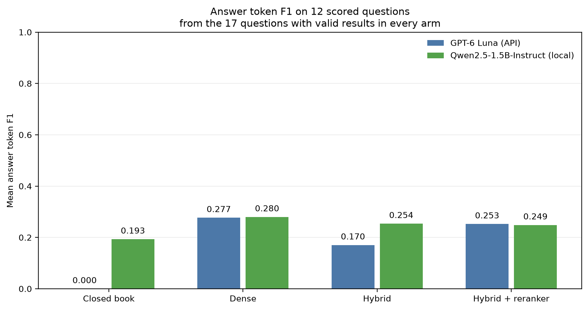

# Offline Answer and Citation Evaluation

The provider-neutral prompt builder, response validator, and offline scoring harness support the local generation pilot and the separately configured provider experiment.

### Retrieval contexts prepared for generation

The standard retrieval evaluation scores and saves predictions for the 888 questions with mapped answer evidence. Generation and abstention evaluation also need context for fully unanswerable and unmapped-evidence questions. `scripts/run_retrieval.py --include-unscored-predictions` now retrieves all 1,005 full-validation questions while keeping retrieval metric rows limited to the same 888 scoreable questions.

Python 3.11.9 context runs for Dense, Hybrid, and Hybrid + reranker are saved under `results/experiments/generation_contexts/{dense,hybrid,hybrid_reranked}/evaluation/token-aware/`. Each prediction file contains 1,005 unique question IDs and five passages for Dense/Hybrid; the reranker file preserves its available 7–20 ranked candidates, of which the first five form the intended generation context. All three question-ID sets match the full validation question file exactly. Run configurations record the environment and model revisions. These local retrieval runs are preparation only: no prompts were sent to an LLM and no paid API request was made.

### Balanced pilot prompt batch

`python scripts/prepare_generation_prompts.py --per-stratum 5 --seed 42` creates an offline, paired pilot batch at `results/experiments/generation_pilot_preflight/`. It selects five questions from each available annotation stratum (mapped answerable, answerable with only unmapped evidence, fully unanswerable, and mixed answerability), then creates one prompt per method for each selected question. The current batch contains 20 questions and 80 jobs across closed-book, Dense, Hybrid, and Hybrid + reranker. All four arms use the same question IDs. Closed-book prompts receive only the paper title and question; RAG prompts receive the question and retrieved passages. Gold annotations and reference answers do not appear in the prompt jobs. The manifest records the selected IDs and states that zero API calls were made. Regenerating with the same seed produced the same SHA-256 for `prompts.jsonl`: `5BE4D623A2D34E2E620EDFC7199D14FCF346F92B0930B99C14482F7773FAFEAE`.

### Optional OpenAI execution runner

`scripts/run_openai_generation.py` adds a Responses API adapter for the prepared batch. It uses strict JSON Schema output, sets `store: false`, limits output tokens, sends requests sequentially, and does not retry automatically. By default, it only prints an offline estimate. A real request requires `--execute`, a key in `OPENAI_API_KEY`, explicit input/output prices, and `--max-cost-usd`. Having a key or running the dry-run does not authorize paid calls.

Dry-run example (the budget value below does not authorize usage):

```powershell
python scripts/run_openai_generation.py `
  --input-price-per-million 0.10 `
  --output-price-per-million 0.50 `
  --max-output-tokens 256 `
  --max-cost-usd 0.05
```

Using the published GPT-6 Luna standard text rates as of 2026-10-28 ($0.10 per million input tokens and $0.50 per million output tokens), the current 80-job dry-run estimates $0.0592029: 489,629 estimated input tokens and 20,480 reserved output tokens. An earlier estimate was $0.0449949; it was lower because it did not reserve as much for the response schema and API framing. Rerun the command above for the current estimate; it is a byte-based planning estimate, not provider-measured tokenization. See the [official GPT-6 Luna pricing](https://developers.openai.com/api/docs/models/gpt-6-luna) and [Responses API reference](https://developers.openai.com/api/reference/resources/responses/methods/create).

Before each call, the runner checks the estimated cost of the next request against the remaining configured budget. It then records actual token usage and cost from the provider response. The estimate is not a guaranteed billing ceiling: provider-side tokenization, price changes, and an already in-flight request can make actual charges differ. If observed cumulative usage exceeds the configured amount, the response is checkpointed and no further request is sent. Interrupted requests are journaled as uncertain and are not retried unless the user verifies provider usage and explicitly opts into `--retry-uncertain`.

Each preflight run is also saved as JSON under `results/experiments/generation_pilot_preflight/` with a UTC timestamp, the prompt file SHA-256, model, price inputs, output-token reserve, estimated cost, and chosen limit. Use `--preflight-output` to save a separate record instead of replacing the default estimate.

The 2026-11-06 run used `gpt-6-luna`, `--reasoning-effort none`, a 256-token output limit in every arm, and a user-approved $0.10 run budget. The full 80-job estimate was $0.0592029 at the standard uncached rates. The four-arm smoke run passed all four replies. Subsequent invocations used `--resume` and the same model, reasoning effort, output limit, and prices. A response rejected by the local parser is recorded as invalid with its available provider usage and raw response, and skipped on resume. The cost guard uses the uncached input rate.

### Provider pilot results (2026-11-06)

The [run summary](../results/experiments/generation_pilot/provider_run_summary.json) verifies one request and one terminal record for each of 80 jobs on 20 questions. Five responses from three questions failed the cross-field rule that a structured abstention has an empty answer and no citations. Four raw responses include a natural-language explanation in the answer field and were saved with provider usage. The earlier parser failure stopped execution before it saved the fifth raw response or its usage. That response has a documented budget reserve and was counted as sent when resuming the batch. No failed job was resent.

For a paired comparison, intersected the question IDs across the four validated prediction files. This gives 17 questions from 17 papers, including 12 with a reference answer, 14 with a clear answerability target and 7 with mapped citation targets. The intersection excludes one question with unmapped evidence and two with mixed answerability. The same IDs were used to rescore the local run.

| Method | Valid API outputs (of 20) | API answer token F1 | Local answer token F1 | API answerability accuracy (of 14) | API citation F1 |
| --- | ---: | ---: | ---: | ---: | ---: |
| Closed book | 20 | 0.0000 | 0.1935 | 5/14 | 0.0000 |
| Dense | 18 | 0.2771 | 0.2801 | 8/14 | 0.4143 |
| Hybrid | 18 | 0.1705 | 0.2539 | 8/14 | 0.4286 |
| Hybrid + reranker | 19 | 0.2526 | 0.2486 | 9/14 | 0.4524 |

API answer Exact Match was zero in all four arms. Reranking increased API answer token F1 by 0.0821 over Hybrid, with a 95% paper-cluster bootstrap interval of [−0.0020, 0.1885] from 2,000 replicates. The sample is deliberately stratified and excludes questions with a format failure in any arm. The interval describes resampling within this scored subset. The local and API runs use different decoding controls. The closed-book API arm abstained on all 17 questions under the shared evidence prompt. On the five fully unanswerable questions, Dense and Hybrid each abstained once, and Hybrid + reranker abstained twice. Each API RAG arm also abstained on two clearly answerable questions.

All 63 cited paragraph IDs in the three API RAG arms were present in their supplied contexts. A passage-level check illustrates why that result and factual support are separate. On question `bfbd6040cb95b179118557352e8e3899ef25c525`, Dense answered yes to whether factors other than pitch can cause singing to be out of key. Its citation `1912.01852:p000-001` discusses musical expression and timbre as aspects of conversion quality and does not establish that causal claim. The answer itself acknowledges the lack of direct evidence. Conversely, on the dataset-source question `2c78993524ca62bf1f525b60f2220a374d0e3535`, reranking supplied paragraph `1809.00540:p006-001`, and the API answer both named Deutsche Welle as the source of the IDF corpus and cited that paragraph. The local model cited the same passage but omitted that source from its answer. These are case-level text checks.



Measured usage for 79 responses was 68,967 input tokens and 4,558 output tokens, with zero reported cached input tokens. The estimate at the recorded standard rates is $0.0091757. A $0.0009019 reserve for the response missing usage brings the run's budget accounting to $0.0100776. The provider invoice was not checked. Mean request latency, including network and inference, was 1.16, 1.62, 1.71 and 1.52 seconds for Closed book, Dense, Hybrid and Hybrid + reranker. Hybrid has 19 timing records and the other arms have 20 each. Retrieval ran separately.

The output directory retains the preflights, request ledger, and full valid predictions. [Paired scores](../results/experiments/generation_pilot/paired_valid/generation_comparison.json), the [metric CSV](../results/experiments/generation_pilot/paired_valid/generation_metrics.csv), [API timings](../results/experiments/generation_pilot/latency_metrics.csv), and [68 diagnostic rows](../results/experiments/generation_pilot/paired_valid/diagnostics/generation_error_analysis.csv) are derived from the saved results. The run summary lists excluded IDs and source hashes.

### Local generation pilot

The local pilot runs [Qwen2.5-1.5B-Instruct Q4_K_M](https://huggingface.co/Qwen/Qwen2.5-1.5B-Instruct-GGUF/blob/a615a81362316d7b9f5a7a9c4313adfdf9b54588/qwen2.5-1.5b-instruct-q4_k_m.gguf) at model revision `a615a81362316d7b9f5a7a9c4313adfdf9b54588` using [llama.cpp b12132](https://github.com/ggml-org/llama.cpp/releases/tag/b12132). Both downloads were checked against their published SHA-256 hashes. The server ran on the local RTX 4060 Laptop GPU via Vulkan, with one slot and a 4,096-token context.

`scripts/run_local_generation.py` sends the saved messages to a server listening on `127.0.0.1`. It uses greedy decoding with seed 42, a 256-token output limit and prompt caching disabled. The decoder constrains JSON structure, answer/abstention consistency, and citation IDs. The citation array has at most as many entries as there are available context IDs, and the closed-book arm has no citations. Repeated citations are deduplicated by the existing parser. Context membership therefore checks protocol compliance. Evaluating whether a citation supports an answer requires a separate assessment.

Start the server with the pinned GGUF and use the same model alias. For the recorded run, the server options were `--alias qwen2.5-1.5b-instruct-q4_k_m --host 127.0.0.1 --port 18765 --device Vulkan1 -ngl 99 -c 4096 -np 1 -t 6 --no-context-shift --no-webui`. The device identifier can differ on other hosts.

```powershell
python scripts/run_local_generation.py `
  --port 18765 `
  --model qwen2.5-1.5b-instruct-q4_k_m `
  --runtime-metadata data/cache/local_generation/runtime_metadata.json `
  --output-dir results/experiments/generation_local_reproduction
```

The runtime metadata object documents the actual local setup. Its recorded fields are embedded in the original run manifest. Add `--smoke` with a separate output directory to run the first question in all four arms. The runner refuses existing output directories, writes raw replies or errors for every attempt, and writes paired prediction files only when every job validates. It also records the model, prompt hashes, token usage, and request duration.

### Local pilot results, 2026-11-05

The scored run in `results/experiments/generation_local_qwen25_15b_bounded/` produced 80 validated outputs for 20 questions from 20 papers. It used 72,705 input tokens and 7,568 output tokens, measured by the local server. The longest input was 1,463 tokens and the longest output was 202 tokens. Request latency includes local prompt processing, decoding, and transport. Retrieval contexts were already prepared.

| Method | Answer token F1 (15) | Exact match (15) | Answerability accuracy (15) | Citation F1 (9) | Mean request time |
| --- | ---: | ---: | ---: | ---: | ---: |
| Closed book | 0.3548 | 20.0% | 66.7% | — | 0.300 s |
| Dense | 0.4240 | 26.7% | 66.7% | 0.3175 | 0.781 s |
| Hybrid | 0.3365 | 20.0% | 66.7% | 0.3296 | 0.818 s |
| Hybrid + reranker | 0.3322 | 20.0% | 66.7% | 0.3122 | 0.793 s |

All six paired 95% paper-cluster intervals for answer F1 include zero. The reranker-minus-Hybrid difference was −0.0042, with interval [−0.0494, 0.0435]. Within the nine questions with mapped evidence, Hybrid's evidence Recall@5 was 0.6667 and reranking's was 0.7222. This pilot shows an increase in annotated evidence coverage without a corresponding resolved increase in answer F1.

For the dataset-sources question (`2c78993524ca62bf1f525b60f2220a374d0e3535`), reranking added `1809.00540:p006-001` about Deutsche Welle and increased evidence recall from 0 to 0.5. The model cited that paragraph but omitted Deutsche Welle from the answer. Token F1 was zero for both Hybrid and Hybrid + reranker. All four arms marked every answer as non-abstained, including all five fully unanswerable questions in each arm. Some answers verbally expressed a lack of evidence, but their explicit abstention fields were false.

The scoring JSON contains method metrics, all question-level scores, paired intervals and input fingerprints. The retrieval/answer join records same-question recall and F1. The 20-question sample was deliberately balanced, the decoder configuration was refined on these prompts, and one small quantized model was used. The results are exploratory. Citations were constrained to supplied paragraph IDs, so their perfect context membership reflects the decoding rule. Citation F1 compares IDs to annotations and semantic support remains unevaluated.

The first smoke run had one invalid closed-book citation because the server did not apply the schema sent in that request format. Switching the schema envelope yielded four valid smoke outputs. The first 80-job run had 78 valid outputs and two length stops from repeated citation IDs. After limiting citation-list length, the whole batch was rerun under one configuration. The earlier raw attempts are kept separately and the scores above use only the complete rerun.

### Where evidence use broke down

`scripts/analyze_generation_errors.py` joins the saved answers, scores and displayed passages. It verifies the question, prediction and retrieval file hashes from the scored comparison. From the project root, run it with `--comparison results/experiments/generation_local_qwen25_15b_bounded/generation_comparison.json` and `--output-dir` pointing to a new directory. The recorded `diagnostics/` directory contains the 80-row CSV and its JSON summary.

| RAG arm | No mapped evidence in context | Partial mapped set | Complete mapped set | Available mapped evidence went uncited | Mapped citation and zero answer F1 |
| --- | ---: | ---: | ---: | ---: | ---: |
| Dense | 3 | 1 | 5 | 0 | 0 |
| Hybrid | 3 | 0 | 6 | 0 | 0 |
| Hybrid + reranker | 2 | 1 | 6 | 1 | 1 |

The evidence columns cover the same nine questions per arm. A complete set means the top five contain every mapped paragraph from at least one answerable annotation. The last two columns use the union of mapped evidence as the citation reference. Context misses here describe the top five. The candidate-depth analysis in the research report distinguishes retrieval and ranking failures using the saved top 20.

- **Citing a passage can still leave out its answer.** On the dataset-sources question (`2c78993524ca62bf1f525b60f2220a374d0e3535`), reranking brought in the Deutsche Welle paragraph and the model cited it, but the generated answer omitted the source. Answer F1 remained zero.
- **Different citation IDs can reflect a difference in question scope.** For “What dataset did they use?” (`e807d347742b2799bc347c0eff19b4c270449fee`), the reranked context put the annotated BioASQ paragraph first. The answer cited other retrieved paragraphs and named BioASQ and SQuAD 2.0. A cited paragraph explicitly describes experiments with both datasets. The benchmark reference focuses on BioASQ, so this is a citation alignment miss with plausible support for the broader reading of the question.
- **A relevant-looking citation can support a different claim.** For the fully unanswerable TextWorld ACG question (`b2ecfd5480a2a4be98730e2d646dfb84daedab17`), Hybrid listed five scientific keyphrase datasets. The cited passage lists those datasets but gives no connection to TextWorld ACG. The model marked the answer as non-abstained. Each of the four arms missed all five abstentions under the benchmark labels.

Reranking increased answer F1 on 3 of the 15 scored questions, decreased it on 3, and left it unchanged on 9. The case readings illustrate how benchmark alignment and support can diverge. The CSV flags describe annotation alignment, and the examples were inspected against the saved passages. A general semantic support rate would require a separate review protocol and scoring exercise.

## Prediction JSONL schema

Write one JSON object per question to a local JSONL file. `question_id` must match a Qasper record. `answer` is the generated text, `abstained` must explicitly indicate whether the system declined to answer, and `cited_paragraph_ids` contains the parent paragraph IDs cited in the answer. Additional fields such as model and prompt version may be retained.

```json
{"question_id":"<Qasper question id>","answer":"<generated answer>","abstained":false,"cited_paragraph_ids":["<paper_id:p<section>-<paragraph>"]}
```

Each cited paragraph must come from the retrieved context. Pass the matching retrieval predictions file to validate this.

`scientific_rag.generation_prompt.build_generation_messages(question, retrieved, context_k=5)` produces system/user messages and the allowlist of parent paragraph IDs. It preserves the retrieved top-K passage text, including overlapping chunks, while citations refer to parent paragraph IDs. `parse_generation_response(response_text, allowed_citations)` validates strict JSON, abstention shape, and citation IDs before a record is saved.

## Run the scorer

```powershell
python scripts/evaluate_generation.py `
  --prediction-file results/experiments/full_validation/generation_predictions.jsonl `
  --question-file data/processed/full_validation/evaluation_questions.jsonl `
  --retrieval-file results/experiments/generation_contexts/hybrid/evaluation/token-aware/predictions.jsonl `
  --context-k 5 `
  --output results/experiments/full_validation/generation_metrics.json
```

The scorer reads local files and writes aggregate metrics plus per-question scores. For generation results using the new full-question context run, pass the matching method's prediction file from `results/experiments/generation_contexts/`. It makes no network requests and requires no API key.

## Paired method comparison

After predictions exist for at least two methods, compare the same question IDs with paper-cluster bootstrap intervals:

```powershell
python scripts/analyze_generation.py `
  --method closed_book=results/experiments/generation_pilot/paired_valid/closed_book_predictions.jsonl `
  --method dense=results/experiments/generation_pilot/paired_valid/dense_predictions.jsonl `
  --method hybrid=results/experiments/generation_pilot/paired_valid/hybrid_predictions.jsonl `
  --method hybrid_reranked=results/experiments/generation_pilot/paired_valid/hybrid_reranked_predictions.jsonl `
  --retrieval dense=results/experiments/generation_contexts/dense/evaluation/token-aware/predictions.jsonl `
  --retrieval hybrid=results/experiments/generation_contexts/hybrid/evaluation/token-aware/predictions.jsonl `
  --retrieval hybrid_reranked=results/experiments/generation_contexts/hybrid_reranked/evaluation/token-aware/predictions.jsonl `
  --bootstrap-replicates 2000 `
  --seed 42 `
  --output results/experiments/generation_pilot/paired_valid/reproduced_comparison.json
```

The analyzer requires each method to contain exactly the same question IDs; it fails instead of quietly comparing different samples. It reports per-method aggregate metrics, per-question scores, and paired differences in the direction `right-hand method minus left-hand method`, with 95% percentile intervals from paper-cluster resampling. Answer EM/F1, answerability accuracy, and citation precision/recall/F1 use the scorer's established definitions. Citation groundedness is reported as the macro mean of per-question grounded-citation fractions in the bootstrap comparison; the scorer also retains its original micro groundedness summary. For the deliberately balanced 20-question pilot, the bootstrap describes variation within that selected sample and does not make it representative of the full benchmark. All files remain local, and analysis makes no model calls.

Retrieval files may contain the complete 1,005-question context set while the generated predictions contain only the paired pilot subset. The analyzer first validates the full retrieval file against the full question file, rejects duplicate or unknown IDs, and requires context for every generated question in each supplied method. It then selects the paired subset for scoring. The input hash still records the complete retrieval file that was validated.

## Metric rules

- **Answer Exact Match and token F1:** macro average over questions with a nonempty answer reference. Each prediction receives its best score across all answerable annotator references. Text is Unicode-normalized, lowercased, stripped of punctuation and English articles; `true`/`yes` and `false`/`no` are canonicalized to the same yes/no form.
- **Answerability accuracy:** computed on clearly answerable and fully unanswerable questions. Mixed-answerability questions are excluded because their annotations do not define one answerability target. The scorer reports the confusion counts.
- **Citation precision:** fraction of unique cited paragraphs found in the union of mapped answerable evidence annotations.
- **Citation recall:** best coverage of a valid annotator evidence set by the unique cited paragraphs.
- **Citation groundedness:** when a retrieval file is supplied, fraction of citations present in the first K retrieved parent paragraphs, including fully unanswerable and unmapped-evidence questions. Membership in the shown context does not require mapped gold evidence; gold citation precision/recall remain limited to questions with mapped evidence. `groundedness_question_count` counts predictions with a supplied retrieval record, including zero-citation abstentions; a question with no citations has undefined per-question groundedness, and the micro denominator counts only cited IDs. This checks whether a citation came from the shown context; it does not prove the cited text entails the answer.

The Qasper annotations can be incomplete or disagree. Citation support and answer F1 are therefore benchmark-alignment measures, not substitutes for human review. Mixed answerability and unmapped evidence counts remain visible in the output/other dataset reports and should be discussed alongside any generated results.

To rebuild the answer F1 figure offline, pass the two saved comparison JSON files to `scripts/generate_figures.py --generation-comparisons`, with the provider comparison first and the same-question local comparison second. The latter is in `paired_valid/local_reference/`.
