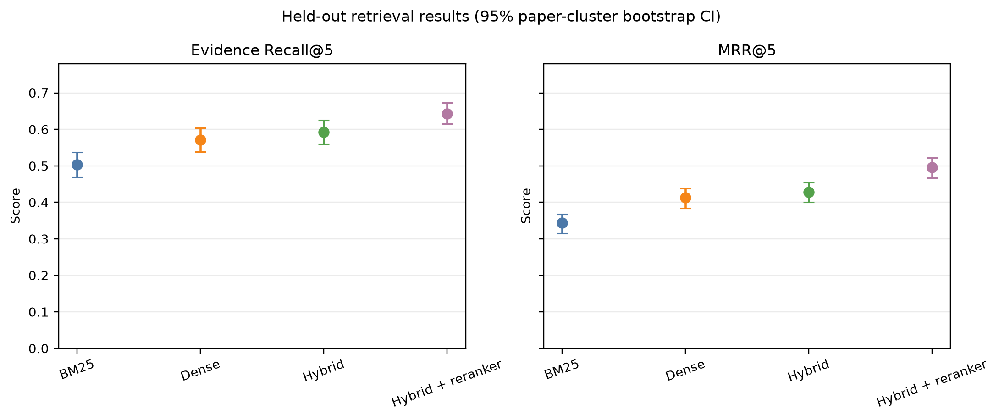
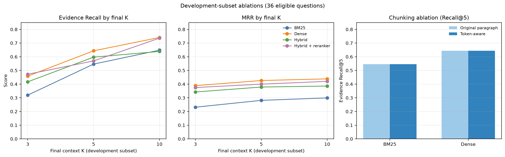

# Evaluating Retrieval and Reranking Strategies for Scientific Question Answering

## Abstract

This study evaluates BM25, dense retrieval, Reciprocal Rank Fusion (RRF) hybrid retrieval, and a Cross-Encoder reranker on Qasper, a dataset of questions anchored in research papers. The main comparison uses all 281 papers in the official validation split and the 888 questions with at least one answerable annotation mapped to source evidence. Retrieval is constrained to each question's associated paper, and evidence is scored at the original-paragraph level. Dense and Hybrid outperform BM25 on all four retrieval metrics in the paired paper-cluster bootstrap analysis. Hybrid's point estimates exceed Dense, with intervals that include zero. Reranking improves Recall@5 by 0.050 and MRR@5 by 0.068 over Hybrid, adding approximately 288 ms of mean local CPU latency per question. Candidate-depth analysis finds fewer ranking failures after reranking and the same number of questions whose candidates lack mapped evidence. A 12-case human review and two generation pilots examine evidence use. The local Qwen2.5-1.5B-Instruct pilot validated all 80 responses. The GPT-6 Luna pilot validated 75 of 80 responses, leaving 17 questions with valid results in all four arms. The paired intervals for the effect of reranking on answer token F1 include zero in both pilots.

## 1. Introduction

Scientific question answering requires locating evidence in papers that are longer and more specialized than typical web snippets. In a RAG system, retrieval determines which source passages are available to a generator. A relevant passage can be absent from the candidate pool (a retrieval failure), or present but ranked below the context limit (a ranking failure). These error types motivate a controlled comparison of lexical retrieval, semantic retrieval, rank fusion, and neural reranking before evaluating generated answers.

This project asks how dense and hybrid methods compare with BM25 on evidence retrieval, whether a Cross-Encoder improves the final ranking of hybrid candidates, and what accuracy–latency trade-offs accompany those changes. The generation pilots examine whether evidence retrieval improvements translate into better answers with decoding settings fixed within each model run.

The contribution is an independently implemented, reproducible evaluation pipeline for Qasper sampling, evidence mapping, token-aware passage construction, retrieval, ranking, scoring, cluster bootstrap analysis, and error classification. It uses public datasets and established open-source libraries; it does not claim a new retrieval model or a new benchmark.

## 2. Related Work

Qasper was introduced as a dataset of information-seeking questions and answers anchored in NLP research papers (Dasigi et al., 2021). Its questions are associated with papers and include multiple answer annotations and evidence passages, making it suitable for studying paper-grounded retrieval. Evidence annotations can differ across annotators and may not map exactly to the text representation, so this study preserves annotation alternatives and reports mapping coverage.

Dense passage representations are commonly used to retrieve semantically related text; Sentence-BERT provides sentence embeddings suitable for similarity search (Reimers and Gurevych, 2019). BM25 provides a lexical baseline. Reciprocal Rank Fusion combines ranked lists without requiring score calibration and is used here to fuse BM25 and dense candidates (Cormack et al., 2009). A Cross-Encoder jointly scores a query–passage pair and can rerank a candidate set, following the passage reranking approach described by Nogueira and Cho (2019). These components are prior methods and tools; the project contribution is their controlled evaluation and analysis on this Qasper setup.

## 3. Dataset and Methodology

### 3.1 Dataset and split

The data are from the public Qasper dataset. The full official `validation` split contains 281 papers and 1,005 questions. The main comparison scores 888 questions with mapped evidence across 276 paper clusters. A further 60 questions are fully unanswerable, 75 contain both answerable and unanswerable annotations, and some answerable questions do not have any mapped evidence. The data pipeline preserves these records and reports why they are not included in retrieval scoring.

The source repository revision is `fdc9d8214fbab5dd782958601db4d678e6934a54`; the official Parquet conversion revision is `06806e4608976fc2fac0a090ac425d5b2b29caf4`. Sampling and experiment configuration use seed 42. The source and conversion revisions, selected IDs, and fingerprints are recorded in the local processed-data manifest. The development sample consists of 15 papers from `train`; held-out retrieval evaluation uses the complete validation split. No result is described as an official test-set result.

### 3.2 Evidence preparation and scoring population

The 281 papers contain 13,266 nonempty paragraph units. They expand to 13,315 token-aware retrieval passages with a maximum length of 450 model tokens and 50-token overlap; each child passage retains its parent paragraph identifier. Evidence is mapped to source paragraphs using normalized exact text matching rather than permissive substring matching. Of 2,808 answerable evidence items, 2,426 (86.4%) map to a paragraph. The remaining 382 are retained in prepared data and quality reports, but are not treated as retrieval misses. The scored population comprises questions with at least one answerable annotation and at least one mapped evidence passage.

For Recall@K and complete evidence coverage, the best-matching valid answer-annotation evidence set is used. MRR and Hit use the union of mapped relevant paragraphs from answerable annotations. This avoids requiring simultaneous retrieval of distinct evidence sets supplied by different annotators while still recognizing any annotated relevant paragraph for first-hit measures.

### 3.3 Retrieval systems

All methods search only within the paper linked to the question, matching the Qasper task setup. Final evaluation depth is K=5.

* **BM25:** lexical passage retrieval using a shared case-folded alphanumeric tokenizer for queries and documents.
* **Dense:** normalized Sentence Transformer embeddings with cosine similarity, using `sentence-transformers/multi-qa-MiniLM-L6-cos-v1` at revision `b207367332321f8e44f96e224ef15bc607f4dbf0` and a local ChromaDB index.
* **Hybrid:** fusion of the top 20 BM25 and top 20 dense candidates using RRF with constant 60.
* **Hybrid + reranker:** a Cross-Encoder scores the hybrid candidate set and returns its top five, using `cross-encoder/ms-marco-MiniLM-L6-v2` at revision `233902d25c440f23af6f7d6e94d2946bac0bee0a`.

The implementation uses Sentence Transformers, ChromaDB, `rank-bm25`, NumPy, and scikit-learn as applicable. No model is trained. The original full-validation retrieval runs were conducted on CPU under Python 3.13.16. Separate Python 3.11.9 reruns now cover all four methods at K=5 and K=20 for full validation and the 50-paper pilot, together with development chunking/Top-K ablations. Full-validation per-question retrieval metrics match the historical outputs within 1e-12; the full-validation and pilot error-analysis CSVs are byte-identical, and the 576 development ablation rows match. The saved comparison is `results/experiments/python311_runtime_parity.json`. The latest local Python 3.11 validation on 2026-10-29 recorded 85 tests passed and Ruff passed; remote CI remains unrun. Timings in the main results table are from the original runs and remain specific to their runtime and cache conditions.

### 3.4 Metrics and statistical analysis

Evidence Recall@5 measures the fraction of a valid annotated evidence set retrieved in the first five passages, using the best-matching set. MRR@5 is the reciprocal rank of the first relevant paragraph, Hit@5 indicates whether at least one relevant paragraph appears in the first five, and complete evidence coverage@5 indicates whether a full valid evidence set appears. Retrieval latency is measured per question on the local CPU host.

We report macro means over the same 888 eligible questions and percentile 95% confidence intervals from 2,000 paper-cluster bootstrap replicates with seed 42. Paired comparisons resample per-question metric differences within papers. This accounts for dependence among questions from the same paper. The intervals quantify sampling uncertainty across these validation-paper clusters; they do not establish performance on another benchmark or on Qasper's test split.

## 4. Experimental Setup

The main comparison evaluates every retrieval method on the same questions, paper corpus, passage representation, and final K. Hybrid candidate depth and reranker input are fixed at 20. Retrieval ground-truth annotations are used only for scoring and error classification, not candidate generation or ranking. The Cross-Encoder receives only passages retrieved by Hybrid.

The development sample has 36 eligible questions. It is used for exploratory final-depth and chunking ablations, which are not used to select results from the held-out validation split. A separate 50-paper validation pilot supports early development and is superseded by the complete validation split for the primary comparison. The project reports the pilot separately to preserve its provenance rather than combining it with the full validation results.

## 5. Results

### 5.1 Main retrieval comparison

| Method | Recall@5 (95% CI) | MRR@5 (95% CI) | Hit@5 (95% CI) | Complete coverage@5 (95% CI) | Mean latency | P95 latency |
|---|---:|---:|---:|---:|---:|---:|
| BM25 | 0.504 [0.470, 0.538] | 0.343 [0.315, 0.368] | 0.593 [0.555, 0.629] | 0.446 [0.410, 0.480] | 0.11 ms | 0.20 ms |
| Dense | 0.572 [0.539, 0.604] | 0.413 [0.384, 0.438] | 0.661 [0.625, 0.696] | 0.506 [0.471, 0.541] | 24.72 ms | 32.14 ms |
| Hybrid (RRF) | 0.593 [0.560, 0.626] | 0.428 [0.400, 0.454] | 0.687 [0.654, 0.720] | 0.526 [0.488, 0.563] | 22.89 ms | 26.84 ms |
| Hybrid + reranker | 0.644 [0.616, 0.673] | 0.496 [0.468, 0.522] | 0.736 [0.707, 0.766] | 0.577 [0.546, 0.609] | 310.77 ms | 536.56 ms |

Dense exceeds BM25 in all four paired metrics: the difference in Recall@5 is +0.068 (95% CI [+0.030, +0.107]), and the differences for MRR, Hit, and complete coverage are +0.069, +0.068, and +0.060, respectively, with intervals above zero. Hybrid also exceeds BM25 in all four metrics; the Recall@5 difference is +0.090 [+0.061, +0.117].

Hybrid's point estimate is higher than Dense on each measure, but the paired intervals cross zero: Recall@5 +0.022 [-0.008, +0.051], MRR@5 +0.015 [-0.009, +0.039], Hit@5 +0.026 [-0.007, +0.057], and complete coverage@5 +0.020 [-0.011, +0.052]. Thus these data do not resolve whether RRF improves on Dense retrieval for this evaluation.

Reranker-minus-Hybrid differences are +0.050 [+0.025, +0.076] in Recall@5, +0.068 [+0.041, +0.094] in MRR@5, +0.050 [+0.022, +0.077] in Hit@5, and +0.051 [+0.023, +0.078] in complete coverage. All intervals are above zero in this split. Mean latency increases by approximately 288 ms per question. This is a substantial local CPU cost and should be weighed against the observed retrieval gains; timings are machine- and run-specific.

### 5.2 Candidate depth and error analysis

At candidate depth 20, evidence Recall@20 is 0.841 for BM25, 0.901 for Dense, and 0.906 for both Hybrid and Hybrid + reranker. Because the reranker changes order but not membership, its Recall@20 equals Hybrid by construction. Among 888 eligible questions, top-five misses decompose as follows:

| Method | Top-5 misses | No mapped evidence in top 20 | Evidence in top 20 but outside top 5 |
|---|---:|---:|---:|
| BM25 | 361 | 88 | 273 |
| Dense | 301 | 53 | 248 |
| Hybrid | 278 | 38 | 240 |
| Hybrid + reranker | 234 | 38 | 196 |

The reranker leaves 38 candidate-generation failures unchanged and reduces the number of evidence-bearing cases ranked outside the context from 240 to 196. In this full validation analysis, its gain is associated with reordering evidence in Hybrid's top 20. The case review below examines some of the individual decisions behind this aggregate pattern.

Paired per-question predictions show that reranking changes a Hybrid top-five miss into a hit on 98 questions, while changing a Hybrid hit into a miss on 54 questions. The net difference is 44 additional hit questions, matching the reduction in top-five miss counts. Thus, the average gain coexists with regressions for individual questions.

### 5.3 Illustrative per-question cases

The following cases were selected from the saved full-validation predictions to illustrate both directions of reranker change; they are examples, not a blinded or exhaustive human audit.

A deterministic seed-42 sample of up to three cases from each of four mutually exclusive outcomes (recovered, regressed, candidate-generation failure, and unresolved ranking failure) is available in [`error_case_sample.md`](error_case_sample.md). The sample is regenerated from local predictions by `scripts/export_error_case_sample.py` and includes question IDs, evidence passage IDs, excerpts, and rank positions. One reviewer assessed this 12-case sample in two rounds using the [review protocol](error_case_review_protocol.md).

* **Evidence promoted into context (QID `cc608df2884e1e82679f663ed9d9d67a4b6c03f3`).** For “What evaluation metrics did look at?”, the annotated paragraph `1705.01214:p014-000` was outside Hybrid's top five but ranked second after reranking. The paragraph describes the paper's validation framework, matching the question's target. This is a ranking gain because the evidence was present in the Hybrid candidate pool.
* **Specific evidence promoted to first place (QID `bf3b27a4f4be1f9ae31319877fd0c75c03126fd5`).** For “How many people participated in their evaluation study of table-to-text models?”, the annotated paragraph `1906.01081:p006-001` moved from outside Hybrid's top five to rank one after reranking. It reports that 1,100 tables were sampled and annotations were collected from workers, directly addressing the study's scale.
* **Relevant passage demoted below the context boundary (QID `ffa7f91d6406da11ddf415ef094aaf28f3c3872d`).** For “By how much more does PARENT correlate with human judgements in comparison to other text generation metrics?”, annotated paragraph `1906.01081:p010-001` ranked second under Hybrid but seventh after reranking. Its surrounding paragraph reports correlations by grammaticality, fluency, and semantics; the reranked top five instead favored other passages about metric comparisons. This illustrates how a query–passage scoring model can displace a relevant detail when several passages share the same topic.

These examples are consistent with, but do not prove the cause of, the aggregate error counts. The first two are recovered ranking cases and the third is a harmed case. A broader blinded audit would be needed to characterize systematic failure mechanisms or answer support.

#### Exploratory two-round human review

The reviewer first compared the A/B passages with method identities hidden and then recorded a second preference after seeing the method labels and Qasper references. The first-round record was saved before the second-round materials were prepared. The comparison of the two submissions verified that the first-round judgments were preserved.

| Round | Hybrid preferred | Hybrid + reranker preferred | Tie | Neither |
| --- | ---: | ---: | ---: | ---: |
| Before unblinding | 0 | 6 | 4 | 2 |
| After unblinding | 3 | 4 | 1 | 4 |

The preference changed on 6 of 12 cases. The reviewer explicitly recorded no annotation issue for three cases, an ambiguous question for two, and passage fragmentation for one. Five cases have free-text observations and one issue field is blank. The category counts cover the six entries with explicit choices, and the other observations are retained in the submitted CSV. For example, in case 08 the reviewer noted a difference between a broad question about machine learning methods and references naming particular models. In case 10 the reviewer noted that the reference passage was absent from both contexts and changed the preference from a tie to neither. The input hashes and checked counts are recorded in the [submission check](../results/experiments/error_case_review/stage2_preflight_reviewer1_20261105.json).

The counts describe a single reviewer's judgments on a stratified sample. Both method identities and reference evidence were shown in round two, so the comparison cannot isolate the effect of either disclosure. These results characterize the selected cases and cannot estimate benchmark-wide preferences.

### 5.4 Development-set ablations

The development-set final-depth comparison (36 eligible questions) shows higher evidence recall and Hit at larger K, with weaker changes in MRR. For example, Dense Recall@5 is 0.644 and Recall@10 is 0.741; Hybrid + reranker Recall@5 is 0.569 and Recall@10 is 0.736. These values are exploratory and are not directly comparable to the full validation estimates because they use a different split and question population.

For the development K=5 chunking comparison, BM25 Recall is 0.546 for both original paragraphs and token-aware passages (MRR 0.283 and 0.282). Dense Recall is 0.644 for both (MRR 0.426 in both cases). Few development paragraphs are long enough for token-aware splitting to alter the retrieved evidence in aggregate. This small ablation does not establish that chunking is immaterial for longer documents or broader corpora.

## 6. Discussion

The full validation comparison provides evidence that both Dense and Hybrid retrieval outperform the lexical baseline under the project's evidence-mapping and question-level scoring rules. It does not show a resolved gain for Hybrid over Dense, despite higher Hybrid point estimates. The reranker improves all four measured retrieval metrics over Hybrid and reduces ranking failures, but incurs much higher latency. This suggests that a two-stage system can be useful when ranking quality is prioritized and the additional CPU time is acceptable; it does not establish that the same trade-off holds on other hardware, corpora, or generated-answer tasks.

The candidate analysis clarifies the boundary of reranking: it cannot surface a relevant paragraph that the first-stage retriever did not supply. Hybrid still has 38 eligible questions with no mapped evidence among its top 20. Improvements to candidate recall and context selection are separate engineering and research questions. A deeper candidate pool might recover evidence but also raise latency and crowd the final context; it needs a separately controlled evaluation.

The [local generation pilot](generation_evaluation.md#local-pilot-results-2026-11-05) used Qwen2.5-1.5B-Instruct to produce 80 outputs for the same 20 questions across four arms. On the nine questions with mapped evidence, reranking increased Evidence Recall@5 from 0.6667 to 0.7222. Across the 15 answer-scored questions, Hybrid answer F1 was 0.3365 and Hybrid + reranker was 0.3322. The paired difference was −0.0042 (95% interval [−0.0494, 0.0435]). The pilot provides a concrete case where improved evidence retrieval coexists with an unresolved difference in answer F1. The evaluation measures answer and citation alignment to the annotations. Semantic citation support requires its own assessment.

The [question-level diagnostics](generation_evaluation.md#where-evidence-use-broke-down) separate context coverage from citation alignment. The reranker reduced top-five misses from three to two across the nine mapped pilot questions. Its new evidence hit was cited but omitted from the answer. A different case included a citation to an alternative dataset passage that supported a broader reading of the question. These cases show why answer overlap and paragraph-ID matching capture different parts of the task.

The [GPT-6 Luna API pilot](generation_evaluation.md#provider-pilot-results-2026-11-06) used the same 80 prompts. Five responses failed the abstention format rule across three questions. On the 17 common valid questions, 12 had reference answers for scoring. Reranking increased answer token F1 from 0.1705 to 0.2526, with a paired difference of 0.0821 and a 95% interval of [−0.0020, 0.1885]. The matched local scores were 0.2539 and 0.2486, respectively. The API model used the Deutsche Welle evidence in its answer when reranking supplied it. A separate answer cited a supplied passage about singing conversion quality, yet asserted a causal claim about singing out of key that the passage did not establish. The [generation evaluation](generation_evaluation.md) records the examples, answerability counts, citation scores, API latency, and estimated cost from observed token counts.

## 7. Limitations

The retrieval evaluation covers the Qasper validation split. Exact normalized paragraph matching maps 86.4% of answerable evidence items. The remaining 382 are retained but omitted from paragraph-retrieval scoring, which may affect the scored population. Of these items, 253 exactly match same-paper figure or table captions and 129 exactly match source section headings. Two headings have empty bodies in the converted source. Captions and headings are outside the paragraph corpus. [Evidence mapping diagnostic](unmapped_evidence_analysis.md)

Question-type groups overlap. Smaller groups, including yes/no (102 questions) and mixed answerability (65), have less precise estimates. The development ablations cover 36 eligible questions. Retrieval latency is specific to the local CPU, while API latency includes the network and provider inference.

The human review covers one reviewer and 12 selected retrieval cases. Each generation run uses the same 20 deliberately selected questions. The API comparisons exclude three questions because one or more arms failed format validation, so the scored subset can differ in difficulty from the attempted sample. The pilots use different decoding controls, and the semantic support checks cover individual examples. The API cost is an estimate from measured usage with a separate reserve for one response. The provider invoice was not verified.

Python 3.11.9 reruns reproduce the stored Python 3.13.16 retrieval metrics and ranked passage IDs for full validation, the 50-paper pilot, and development ablations. Latency remains run-specific. Remote CI has not run.

## 8. Conclusion and next work

On the full Qasper validation split, Dense and Hybrid improve on BM25 under paired paper-cluster bootstrap comparisons. Hybrid does not show a statistically resolved improvement over Dense. A Cross-Encoder reranker improves the measured retrieval metrics over Hybrid by promoting evidence already present in the candidate set, at a substantial CPU latency cost. These conclusions concern evidence retrieval only.

The two generation pilots give different point estimates for the effect of reranking on answer F1, with both paired intervals crossing zero. An expanded generation sample and multiple reviewers could improve precision and estimate agreement on factual support. The local pipeline, figures, experiment records and tests are available in this workspace. GitHub publication and remote CI depend on repository access and publication authorization.

## References

1. Dasigi, P. et al. (2021). *A Dataset of Information-Seeking Questions and Answers Anchored in Research Papers*. NAACL-HLT. [ACL Anthology](https://aclanthology.org/2021.naacl-main.365/).
2. Cormack, G. V., Clarke, C. L. A., and Büttcher, S. (2009). *Reciprocal Rank Fusion outperforms Condorcet and individual rank learning methods*. SIGIR. [DOI](https://doi.org/10.1145/1571941.1572114).
3. Reimers, N. and Gurevych, I. (2019). *Sentence-BERT: Sentence Embeddings using Siamese BERT-Networks*. [arXiv:1908.10084](https://arxiv.org/abs/1908.10084).
4. Nogueira, R. and Cho, K. (2019). *Passage Re-ranking with BERT*. [arXiv:1901.04085](https://arxiv.org/abs/1901.04085).
5. Qasper dataset card. [Hugging Face](https://huggingface.co/datasets/allenai/qasper).
